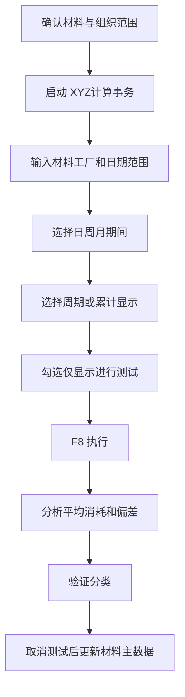

# 运行 XYZ 分析并更新材料分类

> **用途：** 基于历史消耗按日、周或月计算平均消耗及平均绝对偏差百分比，预览或更新材料主数据中的 XYZ 标识。  
> **Transaction Code：** `/JA41/XYZ_01`  
> **来源文件：** `XYZ-Analyse A41S-Doku.docx`  
> **状态：** 历史资料整理；自定义事务、工作流、阈值、数据源和更新字段必须在当前系统验证。

## 1. 适用范围与权限

- 适用于供应商主数据工作流或物料消耗稳定性分析。
- 生产主数据更新、阈值定制和消息重发均属高影响操作，应执行四眼复核。
- 示例公司、品牌、人员、邮箱、供应商、材料、地点和组织编号不写入匿名化流程。

## 2. 流程图

## 3. 页面与字段

| 页面/区域 | 字段或控件 | 填写/选择 | 说明与风险 |
|---|---|---|---|
| XYZ Ermittlung | Material von/bis | 材料范围 | 批量前先小范围 |
| XYZ Ermittlung | Werk | 目标工厂 | 分析按组织范围执行 |
| XYZ Ermittlung | Verbrauchsdatum von/bis | 历史消耗期间 | 应覆盖具有代表性的周期 |
| Auswertung Periode | Tag / Woche / Monat | 选择一个 | 决定消耗聚合粒度 |
| Darstellung | periodisch / kumuliert | 选择 | 周期明细或累计视图 |
| Verbuchung | nur Anzeige, keine Verbuchung | 首次勾选 | 只预览，不更新材料主数据 |
| Datenquelle | S033-MGVBR | 总消耗数量 | 历史附加方案的数据基础 |
| Ergebnis | Durchschnittsverbrauch | 平均每期消耗 | 计算分类基础 |
| Ergebnis | mittlere absolute Abweichung % | 平均绝对偏差百分比 | 与定制阈值比较 |
| Ergebnis | XYZ-Kennzeichen | X / Y / Z | 更新到 MRP 视图的标准字段 |

## 4. 详细操作

1. **前置**  
   确定材料范围、工厂、分析期间和需要排除的异常期间，例如停产、一次性项目或库存调整。
2. **启动**  
   输入 `/JA41/XYZ_01`。命令字段可能需要前缀 `/n`，但事务本体不含 `/n`。
3. **范围**  
   维护材料、工厂和消耗日期范围。批量更新前先选择少量代表材料。
4. **期间粒度**  
   选择 Tag、Woche 或 Monat。短周期高频材料可按周，季节性材料应覆盖至少完整季节或年度。
5. **显示方式**  
   选择 periodisch 查看每期消耗，或 kumuliert 查看累计结果。
6. **测试**  
   勾选 `nur Anzeige, keine Verbuchung`，按 F8 执行。
7. **分析**  
   检查每期消耗、总消耗、平均消耗、平均绝对偏差百分比和拟定 XYZ 类别。
8. **异常复核**  
   如果材料因缺货、一次性需求或数据缺失导致异常波动，先修正数据范围或单独处理。
9. **正式更新**  
   确认阈值与结果正确后，取消仅显示，再次执行，将 XYZ 标识更新到材料主数据。
10. **抽样验证**  
   用材料显示事务检查 MRP 视图中的 XYZ 标识，并保存测试结果。

## 5. 完成检查

- [ ] 材料和工厂范围正确
- [ ] 分析期间有代表性
- [ ] 周期粒度合理
- [ ] 首次运行仅显示
- [ ] 异常消耗已复核
- [ ] 分类与定制阈值一致
- [ ] 正式更新获得批准
- [ ] 材料主数据抽样通过

## 6. 待确认事项

- ⚠️ S033 信息结构及字段 MGVBR 属于历史 LIS 数据源，S/4HANA 环境可能不再使用。
- ⚠️ 资料未提供计算公式细节之外的异常值处理规则，应建立业务规则。

## 7. 常见风险

- 消息监控显示“已发送”不等于业务处理已完成，仍需检查接收方或下游工作流。
- XYZ 阈值不合理会造成整批材料错误分类，并影响 MRP 参数决策。
- 不得在未完成 Testlauf 的情况下批量更新材料主数据。
