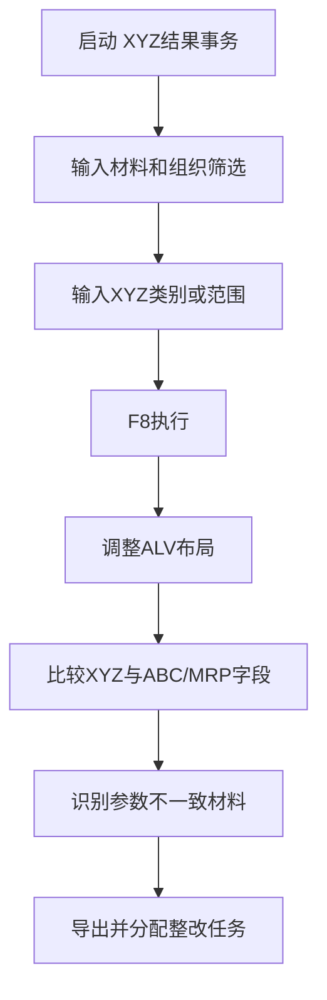

# 查询与分析 XYZ 分类结果

> **用途：** 按材料、工厂、采购组、计划员和 XYZ 类别查询分类结果，并结合 ABC、MRP 与库存参数进行分析。  
> **Transaction Code：** `/JA41/XYZ_02`  
> **来源文件：** `XYZ-Analyse A41S-Doku.docx`  
> **状态：** 历史资料整理；自定义事务、工作流、阈值、数据源和更新字段必须在当前系统验证。

## 1. 适用范围与权限

- 适用于供应商主数据工作流或物料消耗稳定性分析。
- 生产主数据更新、阈值定制和消息重发均属高影响操作，应执行四眼复核。
- 示例公司、品牌、人员、邮箱、供应商、材料、地点和组织编号不写入匿名化流程。

## 2. 流程图

## 3. 页面与字段

| 页面/区域 | 字段或控件 | 填写/选择 | 说明与风险 |
|---|---|---|---|
| XYZ Auswertung | Material von/bis | 材料范围 | 可留空但需组织筛选 |
| XYZ Auswertung | Werk | 目标工厂 | 避免跨工厂误判 |
| XYZ Auswertung | Einkäufergruppe | 采购组 | 按责任筛选 |
| XYZ Auswertung | Disponent | 计划员 | 按MRP责任筛选 |
| XYZ Auswertung | XYZ-Kennzeichen | X / Y / Z | 选择类别 |
| XYZ Auswertung | Losgrößenverfahren | 按需筛选 | 识别分类与批量规则不一致 |
| Ergebnisliste | XYZ-Kennzeichen | 分类结果 | 颜色仅作视觉辅助 |
| Ergebnisliste | ABC-Kennzeichen / Perioden / Planparameter | 相关字段 | 根据当前布局 |
| ALV Toolbar | Layout / Filter / Sortierung / Export | 使用 | 建立个人分析布局 |

## 4. 详细操作

1. **启动**  
   输入 `/JA41/XYZ_02`。
2. **筛选**  
   输入材料、工厂、采购组、计划员、XYZ 类别和必要 MRP 参数。
3. **执行**  
   按 F8 运行。
4. **布局**  
   通过 ALV 添加材料描述、XYZ、ABC、计划员、MRP 类型、批量规则、安全库存、计划交期等关键字段。
5. **解释**  
   X 通常表示消耗稳定、预测性较高；Y 表示中等波动或趋势/季节性；Z 表示不规则消耗。最终含义以当前阈值定制为准。
6. **组合分析**  
   结合 ABC 价值分类：AX 通常适合紧密预测和自动补货；AZ 需高价值且波动大，应重点人工管理；CX 可简化补货；CZ 可能更适合按需采购。
7. **异常识别**  
   查找例如 Z 类仍使用高自动化预测、X 类却使用过度人工规则等不一致。
8. **输出**  
   导出整改清单，分配给采购员或计划员，并记录参数调整与复核日期。

## 5. 完成检查

- [ ] 筛选范围正确
- [ ] ALV列包含关键MRP字段
- [ ] 颜色未替代字段值判断
- [ ] ABC/XYZ组合有业务解释
- [ ] 异常材料有负责人
- [ ] 导出文件不含不必要个人数据

## 6. 待确认事项

- ⚠️ X/Y/Z 的业务解释是通用方法，实际类别边界由当前自定义表决定。
- ⚠️ ABC 仍应使用标准 ABC 分析事务或当前替代报表。

## 7. 常见风险

- 消息监控显示“已发送”不等于业务处理已完成，仍需检查接收方或下游工作流。
- XYZ 阈值不合理会造成整批材料错误分类，并影响 MRP 参数决策。
- 不得在未完成 Testlauf 的情况下批量更新材料主数据。
