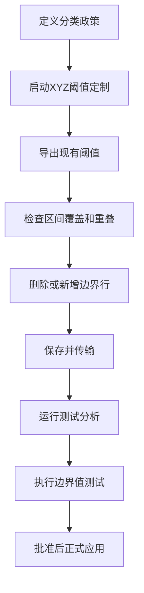

# 维护 XYZ 分类阈值

> **用途：** 维护平均绝对偏差百分比到 X、Y、Z 类别的映射边界，并通过测试运行验证分类覆盖和边界连续性。  
> **Transaction Code：** `/JA41/XYZ_STAT`  
> **来源文件：** `XYZ-Analyse A41S-Doku.docx`  
> **状态：** 历史资料整理；自定义事务、工作流、阈值、数据源和更新字段必须在当前系统验证。

## 1. 适用范围与权限

- 适用于供应商主数据工作流或物料消耗稳定性分析。
- 生产主数据更新、阈值定制和消息重发均属高影响操作，应执行四眼复核。
- 示例公司、品牌、人员、邮箱、供应商、材料、地点和组织编号不写入匿名化流程。

## 2. 流程图

## 3. 页面与字段

| 页面/区域 | 字段或控件 | 填写/选择 | 说明与风险 |
|---|---|---|---|
| XYZ Customizing | Untergrenze Abweichung % | 偏差下限 | 必须连续且不重复 |
| XYZ Customizing | Obergrenze Abweichung % | 偏差上限 | 覆盖预期全部偏差范围 |
| XYZ Customizing | XYZ-Kennzeichen | X / Y / Z | 对应类别 |
| Toolbar | Löschen / Neue Einträge | 删除/新增 | 高风险配置变更 |
| Speichern | Customizing-Auftrag | 保存/传输 | 按当前变更管理 |
| XYZ Test | nur Anzeige, keine Verbuchung | 勾选 | 变更后只预览 |

## 4. 详细操作

1. **政策**  
   由采购、计划和库存管理共同定义 X/Y/Z 偏差区间及业务含义。
2. **备份**  
   在修改前导出现有阈值和受影响材料分类。
3. **启动**  
   输入 `/JA41/XYZ_STAT`。
4. **检查**  
   确保区间没有重叠、空档或反向边界；明确边界值属于前一档还是后一档。
5. **修改**  
   通过删除和新增维护阈值。不要直接在生产系统试错。
6. **保存**  
   保存到批准的定制请求并传输到测试系统。
7. **测试**  
   用 `/JA41/XYZ_01` 勾选仅显示，运行代表性材料集合。
8. **边界值**  
   至少测试每个边界的下方、等于边界和上方，例如阈值 10% 时测试 9.99%、10.00%、10.01%。
9. **批准**  
   对分类变化数量和 MRP 影响进行评审后上线。

## 5. 完成检查

- [ ] 分类政策有批准
- [ ] 原阈值已备份
- [ ] 区间无重叠或空档
- [ ] 边界归属明确
- [ ] 变更通过测试传输
- [ ] 只显示测试完成
- [ ] 边界值测试通过
- [ ] 影响材料数量已评估

## 6. 待确认事项

- ⚠️ 源文件截图中的具体阈值不可直接沿用，匿名化流程不保存这些数值。

## 7. 常见风险

- 消息监控显示“已发送”不等于业务处理已完成，仍需检查接收方或下游工作流。
- XYZ 阈值不合理会造成整批材料错误分类，并影响 MRP 参数决策。
- 不得在未完成 Testlauf 的情况下批量更新材料主数据。
