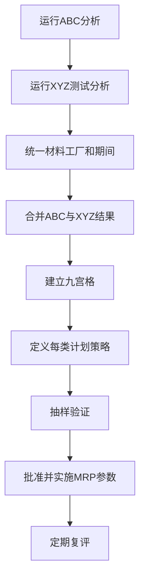

# 结合 ABC 与 XYZ 分析制定物料计划策略

> **用途：** 将价值或需求重要性 ABC 分类与消耗稳定性 XYZ 分类结合，用于选择预测、补货、库存和人工管理策略。  
> **Transaction Code：** `MC40`, `MC41`, `/JA41/XYZ_01`, `/JA41/XYZ_02`  
> **来源文件：** `XYZ-Analyse A41S-Doku.docx`  
> **状态：** 历史资料整理；自定义事务、工作流、阈值、数据源和更新字段必须在当前系统验证。

## 1. 适用范围与权限

- 适用于供应商主数据工作流或物料消耗稳定性分析。
- 生产主数据更新、阈值定制和消息重发均属高影响操作，应执行四眼复核。
- 示例公司、品牌、人员、邮箱、供应商、材料、地点和组织编号不写入匿名化流程。

## 2. 流程图

## 3. 页面与字段

| 页面/区域 | 字段或控件 | 填写/选择 | 说明与风险 |
|---|---|---|---|
| ABC nach Bedarfen | MC40 | 按需求价值分类 | 当前系统标准事务 |
| ABC nach Verbrauchswerten | MC41 | 按消耗价值分类 | 当前系统标准事务 |
| XYZ Ermittlung | /JA41/XYZ_01 | 消耗波动分类 | 先测试运行 |
| XYZ Auswertung | /JA41/XYZ_02 | 结果清单 | 导出或ALV分析 |
| AX | 策略示例 | 高价值+稳定 | 高频监控、精准预测、较低缓冲 |
| AZ | 策略示例 | 高价值+不规则 | 人工审查、供应风险管理、谨慎库存 |
| CX | 策略示例 | 低价值+稳定 | 自动补货、简化采购 |
| CZ | 策略示例 | 低价值+不规则 | 按需采购、减少维护成本 |

## 4. 详细操作

1. **ABC**  
   根据业务目的选择 `MC40` 需求价值分析或 `MC41` 消耗价值分析。
2. **XYZ**  
   使用 `/JA41/XYZ_01` 对同一材料、工厂和尽量一致的统计期间运行测试分析。
3. **统一口径**  
   确保 ABC 和 XYZ 使用相同工厂、材料范围、期间、单位和异常数据策略。
4. **合并**  
   将 ABC 类别与 XYZ 类别组合为 AX、AY、AZ、BX、BY、BZ、CX、CY、CZ。
5. **策略**  
   为每个组合定义预测方法、MRP 类型、批量规则、安全库存、订货频率、供应商策略和审核频率。
6. **重点**  
   优先处理 AX 与 AZ。AX 对预测误差和缺货成本敏感；AZ 对供应商、项目需求和人工判断要求高。
7. **实施**  
   变更 MRP 参数前先抽样模拟 MD04/MRP 结果，再经计划、采购和财务批准。
8. **复评**  
   至少按年度或业务波动显著变化时重新运行，记录分类迁移。

## 5. 完成检查

- [ ] ABC/XYZ范围和期间一致
- [ ] 币种与单位可比
- [ ] 异常数据规则一致
- [ ] 九宫格策略已批准
- [ ] 重点材料经过模拟
- [ ] MRP参数变更有四眼复核
- [ ] 复评周期已定义

## 6. 待确认事项

- ⚠️ ABC/XYZ策略应结合交期、MOQ、保质期、供应风险和服务水平，不能只按分类自动决定。

## 7. 常见风险

- 消息监控显示“已发送”不等于业务处理已完成，仍需检查接收方或下游工作流。
- XYZ 阈值不合理会造成整批材料错误分类，并影响 MRP 参数决策。
- 不得在未完成 Testlauf 的情况下批量更新材料主数据。
