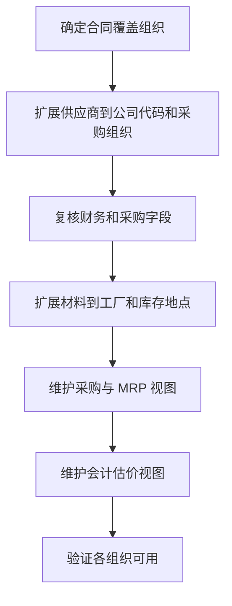

# 准备中央采购合同的跨组织主数据

> **用途：** 在创建中央合同时，将供应商和材料扩展至所有允许调用合同的公司代码、采购组织和工厂。  
> **Transaction Code：** `XK01`, `MM01`  
> **来源文件：** `Kontrakt auf Konzernebene anlegen me31k FERTIG.docx`  
> **状态：** 历史资料整理；字段、组织值、权限和签署规则必须在当前系统及现行制度下验证。

## 1. 适用范围与权限

- 适用于采购合同、已科目分配需求、手工采购订单或个人输出签名设置。
- 合同、财务科目分配、固定资产和签署权限均属于高影响数据，应执行四眼复核。
- 示例公司、地点、供应商、人员、编号和金额不写入匿名化流程。

## 2. 流程图

## 3. 页面与字段

| 页面/区域 | 字段或控件 | 填写/选择 | 说明与风险 |
|---|---|---|---|
| XK01 Einstieg | Kreditor | 已有供应商号 | 使用现有编号扩展，不创建重复编号 |
| XK01 Einstieg | Buchungskreis | 目标公司代码 | 按合同覆盖组织 |
| XK01 Einstieg | Einkaufsorganisation | 目标采购组织 | 按合同覆盖组织 |
| Buchhaltung | Abstimmkonto | 当前供应商统驭科目 | 由财务确认 |
| Buchhaltung | Zahlungsbedingung / Zahlwege | 付款条件/方式 | 不得照搬历史示例 |
| Einkaufsdaten | Bestellwährung / Zahlungsbedingung | 合同币种/付款条件 | 与中央合同一致 |
| Einkaufsdaten | WE-bez.RechnPrüfung / Bestätigungspflicht | 按采购政策 | 影响发票与确认 |
| MM01 Einstieg | Material | 已有材料号 | 扩展至目标工厂 |
| Organisationsebenen | Werk / Lagerort | 目标工厂/库存地点 | 必须属于允许调用范围 |
| Einkauf | Einkäufergruppe | 目标工厂采购组 | 与工厂责任匹配 |
| Disposition 1 | Disponent | 目标工厂计划员 | 历史资料要求与采购组协调 |
| Disposition 1 | Dispositionsmerkmal / Losgröße | PD / EX 或当前策略 | 用当前 MRP 模板 |
| Disposition 2 | Beschaffungsart / Planlieferzeit | F / 实际天数 | 外购及计划交期 |
| Disposition 3 | Verfügbarkeitsprüfung | 当前检查组 | 按工厂策略 |
| Buchhaltung 1 | Bewertungsklasse / Preissteuerung | 当前会计模板 | 由财务/成本核算确认 |

## 4. 详细操作

1. **组织清单**  
   列出所有可调用中央合同的公司代码、采购组织、工厂和库存地点。
2. **供应商扩展**  
   用 `XK01` 输入已有供应商号以及目标公司代码和采购组织，逐页维护必填字段。
3. **财务复核**  
   统驭科目、付款条件、付款方式、付款冻结和催款字段由财务确认。
4. **采购复核**  
   检查币种、付款条件、收货相关发票校验、确认义务和退货控制。
5. **材料扩展**  
   用 `MM01` 输入已有材料号，选择目标工厂所需采购、MRP、会计和库存视图。
6. **采购/MRP**  
   维护采购组、计划员、MRP 类型、批量规则、采购类型、计划交期和可用性检查。
7. **会计**  
   维护估价类别和价格控制，禁止未经财务批准复制其他工厂估价数据。
8. **验证**  
   用显示事务或测试订单确认供应商与材料在每个目标组织都可调用。

## 5. 完成检查

- [ ] 无重复供应商或材料主数据
- [ ] 所有目标组织已扩展
- [ ] 财务字段已批准
- [ ] 采购组和计划员匹配工厂
- [ ] MRP 和会计视图完整
- [ ] 测试调用通过

## 6. 待确认事项

- ⚠️ XK01 在较新系统中可能被 BP 取代。
- ⚠️ 历史资料中的组织值、科目和付款条件已去除。

## 7. 常见风险

- 组织层级、科目分配或伙伴层级填写错误，会导致订单无法调用、错误记账或错误收发票地址。
- 历史示例字段可能已迁移到 BP、Fiori 或 Flexible Workflow，应以当前系统为准。
