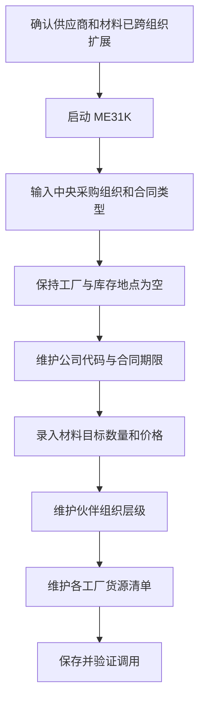

# 创建中央数量合同

> **用途：** 创建不依赖单一工厂或库存地点的中央数量合同，并授权多个内部组织调用。  
> **Transaction Code：** `ME31K`, `ME32K`, `ME33K`  
> **来源文件：** `Kontrakt auf Konzernebene anlegen me31k FERTIG.docx`  
> **状态：** 历史资料整理；字段、组织值、权限和签署规则必须在当前系统及现行制度下验证。

## 1. 适用范围与权限

- 适用于采购合同、已科目分配需求、手工采购订单或个人输出签名设置。
- 合同、财务科目分配、固定资产和签署权限均属于高影响数据，应执行四眼复核。
- 示例公司、地点、供应商、人员、编号和金额不写入匿名化流程。

## 2. 流程图

## 3. 页面与字段

| 页面/区域 | 字段或控件 | 填写/选择 | 说明与风险 |
|---|---|---|---|
| ME31K Einstieg | Lieferant | 合同供应商 | 必须已扩展到相关采购组织 |
| ME31K Einstieg | Vertragsart | MK 或当前数量合同类型 | 按当前配置 |
| ME31K Einstieg | Einkaufsorganisation | 中央采购组织 | 历史特定值不保留 |
| ME31K Einstieg | Einkäufergruppe | 负责采购组 | 合同负责人 |
| ME31K Einstieg | Werk / Lagerort | 留空 | 使合同不绑定某一工厂或库存地点 |
| Popup | Buchungskreis | 中央合同公司代码 | 当采购组织未绑定公司代码时补录 |
| Kopfdaten | Laufzeitbeginn / Laufzeitende | 开始/结束日期 | 结束日期必填 |
| Kopfdaten | Zielwert / Währung | 目标值/币种 | 如适用 |
| Kopfdaten | Zahlungsbedingung / Incoterms | 合同条件 | 以协议为准 |
| Positionsübersicht | Material / Zielmenge / Nettopreis / Preiseinheit | 材料/目标量/价格 | 统一单位和币种 |
| Positionsdetails | Planlieferzeit / Überlieferung / Losgröße | 按合同 | 可覆盖 Infosatz 的计划交期 |
| Zusatzkonditionen | Zuschlag / Rabatt | 附加条件 | 按合同维护 |
| Kopf > Partner | Datenhaltungsebenen | 允许调用的采购组织/工厂 | 逐层维护地址与伙伴 |
| Position > Orderbuch pflegen | Werk / Dispositionskennzeichen | 相关工厂/计划标识 | 支持 MRP 自动分配合同 |

## 4. 详细操作

1. **前置检查**  
   确认供应商及材料已扩展到所有合同调用组织。
2. **入口**  
   输入 `ME31K`，维护供应商、合同类型、中央采购组织和采购组。Werk 与 Lagerort 保持空白。
3. **公司代码**  
   若系统提示采购组织未分配公司代码，输入批准的合同公司代码。
4. **抬头**  
   维护 Laufzeitbeginn、必填 Laufzeitende、币种、付款条件、Incoterms 和参考信息。
5. **项目**  
   维护材料、目标数量、净价、价格单位和物料组。
6. **详情**  
   利用 Kopf、Positionsdetails、Zusatzdaten 和 Zusatzkonditionen 维护交期、容差、批量及财务条件。
7. **伙伴层级**  
   通过 Menü > Kopf > Partner，加入允许调用合同的内部组织。
8. **地址责任**  
   逐行选择组织并进入 Ebene，确保订购方、收货方和发票地址对应实际调用实体，而不是中央合同创建组织。
9. **货源清单**  
   选中合同项目，通过 Position > Orderbuch pflegen 为所有相关工厂创建记录并设置 MRP 相关标识。
10. **保存验证**  
   保存合同；在各组织用测试 BANF/订单确认合同可被正确确定。修改用 `ME32K`，显示用 `ME33K`。

## 5. 完成检查

- [ ] 供应商和材料跨组织可用
- [ ] Werk/Lagerort 按中央合同设计留空
- [ ] 合同期限完整
- [ ] 价格与目标数量正确
- [ ] 所有允许组织已维护伙伴层级
- [ ] 地址正确
- [ ] 各工厂货源清单已建
- [ ] 测试订单调用成功

## 6. 待确认事项

- ⚠️ 中央合同伙伴层级与地址逻辑依赖当前定制。
- ⚠️ 历史中央采购组织、公司代码和合同号已去除。

## 7. 常见风险

- 组织层级、科目分配或伙伴层级填写错误，会导致订单无法调用、错误记账或错误收发票地址。
- 历史示例字段可能已迁移到 BP、Fiori 或 Flexible Workflow，应以当前系统为准。
