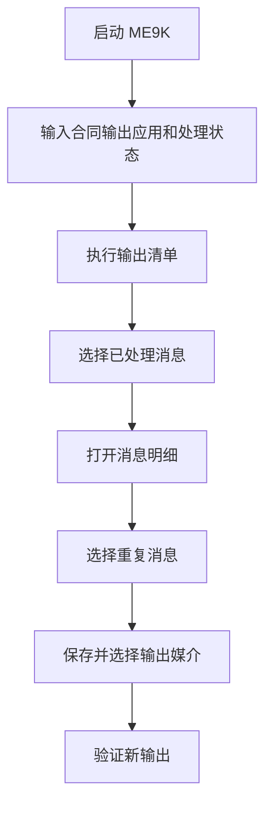

# 重复输出中央合同

> **用途：** 查找已成功处理的合同输出消息，并重新生成 PDF、纸质打印或其他批准媒介。  
> **Transaction Code：** `ME9K`  
> **来源文件：** `Kontrakt auf Konzernebene anlegen me31k FERTIG.docx`  
> **状态：** 历史资料整理；字段、组织值、权限和签署规则必须在当前系统及现行制度下验证。

## 1. 适用范围与权限

- 适用于采购合同、已科目分配需求、手工采购订单或个人输出签名设置。
- 合同、财务科目分配、固定资产和签署权限均属于高影响数据，应执行四眼复核。
- 示例公司、地点、供应商、人员、编号和金额不写入匿名化流程。

## 2. 流程图

## 3. 页面与字段

| 页面/区域 | 字段或控件 | 填写/选择 | 说明与风险 |
|---|---|---|---|
| ME9K Einstieg | Applikation | EV 或当前合同输出应用 | 历史资料 EV=数量合同 |
| ME9K Einstieg | Verarbeitungsstatus | 1 | 历史资料 1=成功处理，用于重复输出 |
| Ausgabeliste | Nachricht | 标记目标消息 | 确认合同号与伙伴 |
| Ausgabeliste | Nachrichtendetail | 点击 | 查看媒介、语言、伙伴和处理协议 |
| Nachrichtendetail | Nachricht wiederholen | 点击 | 创建重复输出 |
| Druckdialog | Ausgabeart | PDF / Papier / 批准媒介 | 按当前输出管理 |

## 4. 详细操作

1. **启动**  
   输入 `ME9K`。
2. **筛选**  
   维护合同输出应用、处理状态、合同号、伙伴和日期范围。
3. **执行**  
   生成输出消息清单。
4. **检查**  
   选择目标消息并打开 Nachrichtendetail；核对合同、语言、接收方和原处理状态。
5. **重复**  
   标记已成功处理的消息，点击 Nachricht wiederholen。
6. **保存输出**  
   保存后在打印/输出对话中选择 PDF、纸质或批准的输出渠道。
7. **验证**  
   确认新消息成功，防止因重复操作向供应商发送多份。

## 5. 完成检查

- [ ] 合同和伙伴正确
- [ ] 只选择目标消息
- [ ] 输出语言与媒介正确
- [ ] 重复输出已验证
- [ ] 未产生非预期重复发送

## 6. 待确认事项

- ⚠️ 当前系统可能已迁移到新的 Output Management，ME9K 可能不再适用。

## 7. 常见风险

- 组织层级、科目分配或伙伴层级填写错误，会导致订单无法调用、错误记账或错误收发票地址。
- 历史示例字段可能已迁移到 BP、Fiori 或 Flexible Workflow，应以当前系统为准。
