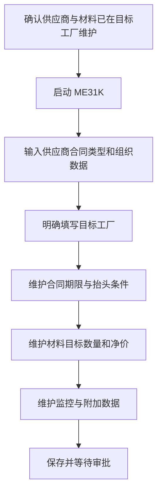

# 创建工厂级数量合同

> **用途：** 为单一工厂创建数量合同，维护期限、目标数量、价格、监控阈值、附加条件和项目文本。  
> **Transaction Code：** `ME31K`, `ME32K`, `ME33K`  
> **来源文件：** `Kontrakt auf Werksebene anlegen me31k FERTIG.docx`  
> **状态：** 历史资料整理；字段、组织值、权限和默认布局必须在当前系统验证。

## 1. 适用范围与权限

- 适用于列表报表、供应商主数据或工厂级合同维护。
- 主数据、合同价格、合同监控和默认布局设置均可能影响其他用户或后续采购，应按权限操作。
- 示例公司、人员、供应商、材料、合同号和组织编号不写入匿名化流程。

## 2. 流程图

## 3. 页面与字段

| 页面/区域 | 字段或控件 | 填写/选择 | 说明与风险 |
|---|---|---|---|
| ME31K Einstieg | Lieferant | 合同供应商 | 必须在目标采购组织有效 |
| ME31K Einstieg | Vertragsart | MK 或当前数量合同类型 | 按当前配置 |
| ME31K Einstieg | Einkaufsorganisation | 目标工厂所属采购组织 | 工厂合同不是中央采购组织 |
| ME31K Einstieg | Einkäufergruppe | 负责采购组 | 合同负责人 |
| ME31K Einstieg | Werk | 目标工厂 | 工厂级合同必须填写 |
| ME31K Einstieg | Lagerort | 按需要 | 通常可为空，按合同范围 |
| ME31K Einstieg | Bestätigungspflicht | 按政策勾选 | 要求订单确认 |
| Kopfdaten | Laufzeitbeginn / Laufzeitende | 开始/结束日期 | 结束日期必填 |
| Kopfdaten | Zahlungsbedingung / Incoterms / Währung | 合同商业条件 | 与签署协议一致 |
| Positionsübersicht | Material / Zielmenge / Nettopreis / Preiseinheit | 材料/目标量/价格 | 统一单位 |
| Positionsdetails | Schwellendatum | 监控日期 | 合同使用监控 |
| Positionsdetails | % Schwellenmenge / % Schwellenwert | 数量/金额阈值 | 例如达到一定比例触发关注 |
| Zusatzdaten | Planlieferzeit | 合同计划交期 | 可短于 Infosatz |
| Konditionen | Zuschlag / Rabatt | 附加条件 | 按合同 |
| Positionstexte | Freitext | 项目文本 | 避免内部敏感信息 |

## 4. 详细操作

1. **前置**  
   确认供应商和材料已在目标工厂、采购组织和公司代码维护。
2. **入口**  
   输入 `ME31K`，填写供应商、合同类型、采购组织、采购组和目标工厂。
3. **期限**  
   在 Kopfdaten 中维护 Laufzeitbeginn 和必填 Laufzeitende，并复核付款条件、币种和 Incoterms。
4. **项目**  
   维护材料、目标数量、净价、价格单位和必要物料组。
5. **监控**  
   在 Positionsdetails 维护 Schwellendatum、Schwellenmenge 和 Schwellenwert，用于合同消耗监控。
6. **附加数据**  
   维护计划交期、交货容差、批量或其他合同特定参数。
7. **条件与文本**  
   维护折扣、附加费和项目文本。
8. **保存**  
   保存合同并记录编号。合同必须完成审批后才能进入货源清单。
9. **后续**  
   修改用 `ME32K`，只读显示用 `ME33K`。

## 5. 完成检查

- [ ] 供应商和材料在目标工厂有效
- [ ] 采购组织与工厂匹配
- [ ] 合同期限完整
- [ ] 目标量和净价正确
- [ ] 监控阈值有业务依据
- [ ] 附加条件与文本复核
- [ ] 合同编号记录
- [ ] 审批已发起

## 6. 待确认事项

- ⚠️ 历史示例中的工厂、采购组织、阈值和合同号已去除。
- ⚠️ Schwellendatum 与百分比阈值是否触发自动消息取决于当前配置。

## 7. 常见风险

- 用户默认布局和全局布局必须区分，避免覆盖其他人员的报表显示。
- 供应商扩展时不得创建重复主记录；财务、采购和语言相关文本应分别复核。
- 合同只有完成审批后才能作为有效供应源进入货源清单或 MRP 自动分配。
