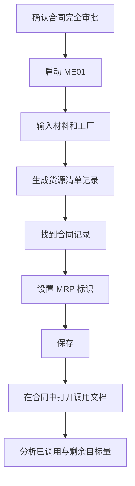

# 维护合同货源清单并监控合同调用量

> **用途：** 在合同完成审批后，将合同写入材料货源清单，并查看已调用数量、未清目标量和关联采购订单。  
> **Transaction Code：** `ME01`, `ME32K`, `ME33K`  
> **来源文件：** `Kontrakt auf Werksebene anlegen me31k FERTIG.docx`  
> **状态：** 历史资料整理；字段、组织值、权限和默认布局必须在当前系统验证。

## 1. 适用范围与权限

- 适用于列表报表、供应商主数据或工厂级合同维护。
- 主数据、合同价格、合同监控和默认布局设置均可能影响其他用户或后续采购，应按权限操作。
- 示例公司、人员、供应商、材料、合同号和组织编号不写入匿名化流程。

## 2. 流程图

## 3. 页面与字段

| 页面/区域 | 字段或控件 | 填写/选择 | 说明与风险 |
|---|---|---|---|
| ME01 Einstieg | Material | 合同材料 | 目标工厂材料 |
| ME01 Einstieg | Werk | 目标工厂 | 与合同工厂一致 |
| Orderbuch | Sätze erzeugen | 点击 | 刷新/生成候选货源记录 |
| Orderbuch | Vertrag / Position | 合同号/项目 | 确认对应已审批合同 |
| Orderbuch | Gültig von/bis | 有效期 | 应与合同期限协调 |
| Orderbuch | Dispokennzeichen | 1 或当前 MRP 标识 | 允许 MRP 自动分配合同 |
| ME32K/ME33K Position | Abrufdokumentation | 点击图标 | 打开合同调用记录 |
| Abrufdokumentation | Bestellung / Bestellmenge / Bestellwert | 关联订单/数量/金额 | 检查调用明细 |
| Abrufdokumentation | Bisherige Abrufmenge / Zielmenge / Offene Zielmenge | 累计调用/目标/剩余 | 监控合同消耗 |

## 4. 详细操作

1. **审批检查**  
   确认合同已完成全部 Freigabeverfahren。未完全批准的合同可能不会出现在货源清单。
2. **货源清单**  
   输入 `ME01`，填写材料和工厂。
3. **生成记录**  
   点击 Sätze erzeugen，使新合同立即显示。
4. **定位合同**  
   找到包含合同号和项目号的记录，核对供应商及有效期。
5. **MRP 标识**  
   将 Dispokennzeichen 设为当前允许 MRP 自动分配合同的值，历史示例为 `1`。
6. **保存**  
   保存货源清单。
7. **调用监控**  
   用 `ME32K` 或 `ME33K` 打开合同，选中项目并点击 Abrufdokumentation。
8. **分析**  
   查看关联采购订单、累计调用数量、目标数量和剩余目标数量，识别超额或即将用尽的合同。

## 5. 完成检查

- [ ] 合同已完全审批
- [ ] 材料与工厂正确
- [ ] 合同记录已生成
- [ ] 有效期与合同一致
- [ ] MRP 标识符合当前规则
- [ ] 货源清单保存成功
- [ ] 合同剩余量已复核

## 6. 待确认事项

- ⚠️ ME33K 通常为显示事务，源文件将调用文档入口描述为 ME32K；两者可用性需实机确认。
- ⚠️ Dispokennzeichen 1 的含义必须确认当前定制。

## 7. 常见风险

- 用户默认布局和全局布局必须区分，避免覆盖其他人员的报表显示。
- 供应商扩展时不得创建重复主记录；财务、采购和语言相关文本应分别复核。
- 合同只有完成审批后才能作为有效供应源进入货源清单或 MRP 自动分配。
