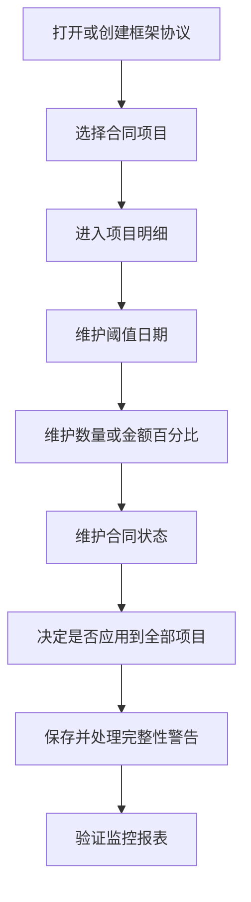

# 维护框架协议监控阈值

> **用途：** 在合同项目中维护重新谈判日期、数量阈值、金额阈值和合同状态，为框架协议监控提供数据基础。  
> **Transaction Code：** `ME31K`, `ME32K`, `ME33K`  
> **来源文件：** `Überwachung von Rahmenverträgen A41S-Doku.docx`  
> **状态：** 历史资料整理；自定义字段、阈值、状态码、报表逻辑及事务码必须在当前系统验证。

## 1. 适用范围与权限

- 适用于框架协议监控、合同续签准备及采购事务码导航。
- 阈值、合同状态和监控变式会影响续签优先级，应由合同负责人及采购主管复核。
- 示例公司、品牌、人员、供应商、材料、合同号、地点和组织编号不写入匿名化流程。

## 2. 流程图

## 3. 页面与字段

| 页面/区域 | 字段或控件 | 填写/选择 | 说明与风险 |
|---|---|---|---|
| Kontrakt > Positionsübersicht | Position | 选择项目 | 双击或 F2 进入项目明细 |
| Positionsdetails > RV Überwachung | Schwellendatum | 重新谈判启动日期 | 建议按合同结束日减采购准备期计算 |
| Positionsdetails > RV Überwachung | % Schwellenmenge | 数量消耗阈值百分比 | 适用于数量合同 |
| Positionsdetails > RV Überwachung | % Schwellenwert | 金额消耗阈值百分比 | 适用于金额合同 |
| Positionsdetails > RV Überwachung | Rahmenvertragsstatus | 当前合同状态 | 由自定义状态表提供 |
| Speichern Warnung | Ja / Nein / Abbrechen | 补录/暂不维护/取消保存 | 不得无意识忽略 |
| Schwellendaten Popup | für alle Positionen | X 或空白 | 可将相同阈值复制到全部项目 |

## 4. 详细操作

1. **打开合同**  
   用 `ME31K` 创建，`ME32K` 修改，或 `ME33K` 显示合同。
2. **项目明细**  
   标记合同项目并双击项目号，或使用 Detail Position/F2 打开明细。
3. **日期阈值**  
   维护 Schwellendatum。推荐逻辑：合同 Laufzeitende 减去后续合同采购、谈判和审批所需时间。
4. **数量阈值**  
   数量合同维护 `% Schwellenmenge`，表示累计调用量达到目标量的何种比例时应开始续签。
5. **金额阈值**  
   金额合同维护 `% Schwellenwert`，表示累计调用金额达到目标值的何种比例时应开始续签。
6. **合同状态**  
   按当前状态表维护 Rahmenvertragsstatus，例如已启动后续谈判或不需要后续合同。匿名文档不保留历史状态代码。
7. **批量项目**  
   如所有合同项目采用相同阈值，可在弹窗中选择 für alle Positionen；应用前先检查不同项目是否确实同类。
8. **保存警告**  
   系统保存时若提示监控数据未维护，可选择 Ja 返回补录，Nein 暂存，或 Abbrechen 取消。标准流程优先补齐。
9. **验证**  
   运行框架协议监控报表，确认合同项目显示正确的阈值日期、数量和金额信号。

## 5. 完成检查

- [ ] 合同项目正确
- [ ] 重新谈判准备期有依据
- [ ] 数量/金额阈值符合合同类型
- [ ] 合同状态有效
- [ ] 批量应用范围正确
- [ ] 保存警告已处理
- [ ] 监控报表显示正确

## 6. 待确认事项

- ⚠️ 合同项目新增字段属于自定义增强，字段位置和保存警告可能不同。
- ⚠️ 阈值日期应结合现实谈判周期，不应机械使用固定天数。

## 7. 常见风险

- 阈值缺失时相应信号灯可能保持不活动，不能据此判断合同无风险。
- 合同消耗量、消耗金额和截止日期使用不同口径，应分别验证。
- 自定义事务和状态表可能已迁移或停用。
