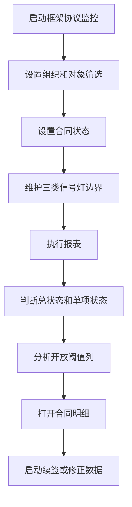

# 使用自定义报表监控框架协议

> **用途：** 按采购组织、工厂、采购组、计划员、供应商、材料和合同状态筛选框架协议，并用日期、数量和金额信号灯识别续签风险。  
> **Transaction Code：** `/JA41/M_REPKONTRAKT`  
> **来源文件：** `Überwachung von Rahmenverträgen A41S-Doku.docx`  
> **状态：** 历史资料整理；自定义字段、阈值、状态码、报表逻辑及事务码必须在当前系统验证。

## 1. 适用范围与权限

- 适用于框架协议监控、合同续签准备及采购事务码导航。
- 阈值、合同状态和监控变式会影响续签优先级，应由合同负责人及采购主管复核。
- 示例公司、品牌、人员、供应商、材料、合同号、地点和组织编号不写入匿名化流程。

## 2. 流程图

## 3. 页面与字段

| 页面/区域 | 字段或控件 | 填写/选择 | 说明与风险 |
|---|---|---|---|
| Selektionsbild | Einkaufsorganisation / Werk | 采购组织/工厂范围 | 限定责任范围 |
| Selektionsbild | Einkäufergruppe / Disponent | 采购组/计划员 | 按负责人筛选 |
| Selektionsbild | Einkaufsbelegart | 合同类型 | 数量合同或金额合同 |
| Selektionsbild | Lieferant / Material / Warengruppe | 供应商/材料/物料组 | 进一步限定 |
| Selektionsbild | Rahmenvertragsstatus | 合同状态 | 可排除不需要后续合同的记录 |
| Ampelfestlegung | Anzahl Tage vor dem Schwellendatum | 绿色/黄色/红色边界 | 单位为日 |
| Ampelfestlegung | Prozentualer Abstand von der Schwellenmenge | 绿色/黄色/红色边界 | 剩余至数量阈值的百分比 |
| Ampelfestlegung | Prozentualer Abstand von dem Schwellenwert | 绿色/黄色/红色边界 | 剩余至金额阈值的百分比 |
| Ergebnis | Gesamtampel | 汇总状态 | 最严重单项决定总状态 |
| Ergebnis | Schw.Dat. | 阈值日期与今天的差值 | 例如阈值日在36天后则显示36 |
| Ergebnis | Schw.M.a. / % Schw.M. | 开放阈值数量绝对值/百分比 | 仅在数量阈值存在时 |
| Ergebnis | Schw.W.a. / % Schw.Wrt. | 开放阈值金额绝对值/百分比 | 仅在金额阈值存在时 |

## 4. 详细操作

1. **启动**  
   输入 `/JA41/M_REPKONTRAKT`，或通过当前菜单打开框架协议监控。
2. **筛选**  
   填写采购组织、工厂、采购组、计划员、合同类型、供应商、材料、物料组和合同状态。
3. **日期信号**  
   维护距离 Schwellendatum 的绿/黄/红边界。资料示例为大于40天绿色、35至40天黄色、小于35天红色，但当前阈值应由业务决定。
4. **数量信号**  
   维护距 Schwellenmenge 的百分比边界。资料示例为剩余大于20%绿色、10至20%黄色、小于10%红色。
5. **金额信号**  
   按相同方式维护距 Schwellenwert 的百分比边界。
6. **执行**  
   按 F8 运行报表。未设置信号边界或合同没有对应阈值时，该信号灯保持不活动。
7. **总状态**  
   总信号灯采用最严重原则：任一红则总红；无红但有黄则总黄；全部绿才总绿。
8. **分析**  
   查看 Schw.Dat.、Schw.M.a.、% Schw.M.、Schw.W.a. 和 % Schw.Wrt.，判断时间、数量和金额中的实际风险来源。
9. **处理**  
   打开目标合同，启动后续合同谈判、调整合同状态、修正阈值数据或记录无需后续协议的依据。

## 5. 完成检查

- [ ] 筛选范围与本人责任一致
- [ ] 三类信号边界有业务依据
- [ ] 不活动信号灯未被当成绿色
- [ ] 红黄合同均有下一步
- [ ] 合同明细与报表一致
- [ ] 续签或状态更新有负责人和期限

## 6. 待确认事项

- ⚠️ 40/35天及20%/10%仅为历史示例，不设为仓库默认阈值。
- ⚠️ 自定义报表实现可能已升级，当前 ABAP 程序与事务需验证。

## 7. 常见风险

- 阈值缺失时相应信号灯可能保持不活动，不能据此判断合同无风险。
- 合同消耗量、消耗金额和截止日期使用不同口径，应分别验证。
- 自定义事务和状态表可能已迁移或停用。
