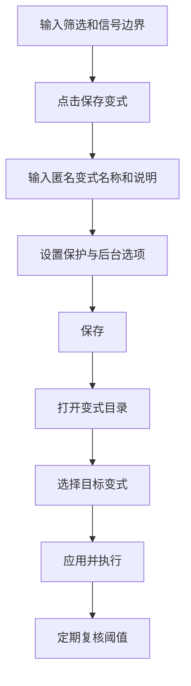

# 保存并调用框架协议监控变式

> **用途：** 将常用的框架协议筛选条件和信号灯边界保存为个人或受控共享变式。  
> **Transaction Code：** `/JA41/M_REPKONTRAKT`  
> **来源文件：** `Überwachung von Rahmenverträgen.docx`  
> **状态：** 历史资料整理；自定义字段、阈值、状态码、报表逻辑及事务码必须在当前系统验证。

## 1. 适用范围与权限

- 适用于框架协议监控、合同续签准备及采购事务码导航。
- 阈值、合同状态和监控变式会影响续签优先级，应由合同负责人及采购主管复核。
- 示例公司、品牌、人员、供应商、材料、合同号、地点和组织编号不写入匿名化流程。

## 2. 流程图

## 3. 页面与字段

| 页面/区域 | 字段或控件 | 填写/选择 | 说明与风险 |
|---|---|---|---|
| Selektionsbild | Einkaufsorganisation / Werk / Einkäufergruppe | 常用范围 | 只保存必要组织条件 |
| Ampelfestlegung | Tage / Mengenabstand / Wertabstand | 阈值边界 | 应与采购政策一致 |
| Variantenattribute | Variantenname | 中性名称 | 不得含人员或公司名称 |
| Variantenattribute | Bedeutung | 用途说明 | 例如“月度合同续签监控” |
| Variantenattribute | Nur für Hintergrundverarbeitung | 按需要 | 后台作业专用 |
| Variantenattribute | Variante schützen | 按权限 | 共享标准变式建议保护 |
| Variantenkatalog | Kurzbeschreibung | 选择 | 核对用途和所有者 |

## 4. 详细操作

1. **配置**  
   在监控选择屏幕输入组织范围、合同状态和信号灯边界。
2. **保存**  
   点击保存变式。
3. **命名**  
   使用中性名称和明确说明，不使用人员、供应商或地点名称。
4. **属性**  
   决定是否仅用于后台处理，并根据权限决定是否保护变式。
5. **调用**  
   通过变式选择按钮打开 Variantenkatalog，选择目标变式并用绿色勾选应用。
6. **执行**  
   检查带入的筛选条件和边界后运行报表。
7. **维护**  
   采购政策或谈判周期变化时更新标准变式，并记录生效日期。

## 5. 完成检查

- [ ] 变式不含敏感名称
- [ ] 筛选范围正确
- [ ] 信号边界经批准
- [ ] 共享变式有保护
- [ ] 应用后条件已复核
- [ ] 变更有记录

## 6. 待确认事项

- ⚠️ 变式作用范围和保护权限取决于当前角色。

## 7. 常见风险

- 阈值缺失时相应信号灯可能保持不活动，不能据此判断合同无风险。
- 合同消耗量、消耗金额和截止日期使用不同口径，应分别验证。
- 自定义事务和状态表可能已迁移或停用。
