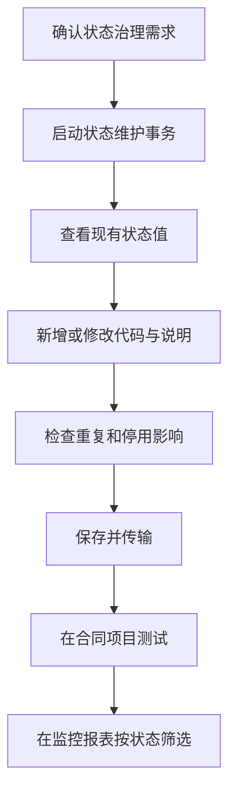

# 维护框架协议状态自定义表

> **用途：** 维护框架协议监控使用的状态值，使报表能够区分需续签、已启动后续谈判和无需后续合同等业务状态。  
> **Transaction Code：** `/JA41/M_RVSTAT`  
> **来源文件：** `Überwachung von Rahmenverträgen A41S-Doku.docx`  
> **状态：** 历史资料整理；自定义字段、阈值、状态码、报表逻辑及事务码必须在当前系统验证。

## 1. 适用范围与权限

- 适用于框架协议监控、合同续签准备及采购事务码导航。
- 阈值、合同状态和监控变式会影响续签优先级，应由合同负责人及采购主管复核。
- 示例公司、品牌、人员、供应商、材料、合同号、地点和组织编号不写入匿名化流程。

## 2. 流程图

## 3. 页面与字段

| 页面/区域 | 字段或控件 | 填写/选择 | 说明与风险 |
|---|---|---|---|
| Customizing | Statuscode | 中性短代码 | 不得复用有其他含义的代码 |
| Customizing | Bezeichnung | 业务说明 | 清楚描述续签处理状态 |
| Kontraktposition | Rahmenvertragsstatus | 状态选择 | 来自自定义表 |
| Speichern Popup | für alle Positionen | 按需要 | 可将状态复制到全部合同项目 |
| Monitor Auswahl | Rahmenvertragsstatus | 筛选 | 按状态包含或排除合同 |

## 4. 详细操作

1. **治理**  
   定义状态清单、责任人、允许的状态转换和停用规则。
2. **维护**  
   输入 `/JA41/M_RVSTAT`，查看现有状态。
3. **新增/修改**  
   维护短代码和明确说明，例如“后续谈判已启动”或“不需要后续合同”。不保留历史厂商默认状态。
4. **影响检查**  
   检查正在使用的合同项目。删除或重定义已有代码前，先迁移现有数据。
5. **保存传输**  
   保存并通过批准的变更/传输流程上线。
6. **合同测试**  
   在合同项目中选择新状态，必要时使用“为所有项目”功能。
7. **报表测试**  
   在框架协议监控中按新状态筛选，并确认显示、排除和信号逻辑正确。

## 5. 完成检查

- [ ] 状态治理获得批准
- [ ] 代码唯一
- [ ] 说明清晰
- [ ] 现有合同影响已评估
- [ ] 变更已传输
- [ ] 合同项目可选择
- [ ] 监控筛选正确

## 6. 待确认事项

- ⚠️ 事务名为历史自定义对象，当前系统可能使用其他维护视图或 Fiori 配置。

## 7. 常见风险

- 阈值缺失时相应信号灯可能保持不活动，不能据此判断合同无风险。
- 合同消耗量、消耗金额和截止日期使用不同口径，应分别验证。
- 自定义事务和状态表可能已迁移或停用。
