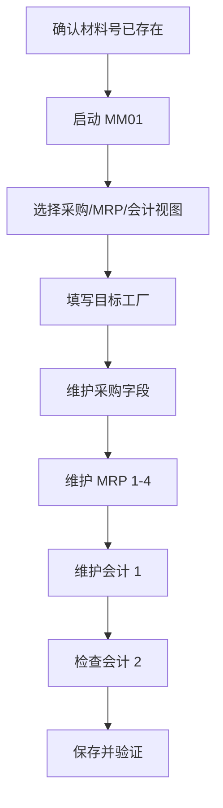

# 将现有材料扩展至工厂采购、MRP 与会计视图

> **用途：** 对已分配材料号的材料，扩展目标工厂的采购、MRP 1-4 和会计 1-2 视图。  
> **Transaction Code：** `MM01`  
> **来源文件：** `Material anlegen in Werk mm01.docx`  
> **状态：** 历史资料整理；字段、组织值、价格导入、消息输出与主数据默认值必须在当前系统验证。

## 1. 适用范围与权限

- 适用于材料扩展、采购催交和采购信息记录批量条件维护。
- 材料估价、采购条件批量导入和催交通知均属高影响操作，应执行四眼复核。
- 示例公司、人员、供应商、材料、订单和组织编号不写入匿名化流程。

## 2. 流程图

## 3. 页面与字段

| 页面/区域 | 字段或控件 | 填写/选择 | 说明与风险 |
|---|---|---|---|
| MM01 Einstieg | Material | 已有材料号 | 本流程不是新编号创建 |
| MM01 Einstieg | Branche / Materialart | 系统自动带出 | 如果不一致应停止并核对 |
| Sichtenauswahl | Einkauf | 勾选 | 采购视图 |
| Sichtenauswahl | Disposition 1-4 | 勾选 | MRP 视图 |
| Sichtenauswahl | Buchhaltung 1-2 | 勾选 | 会计视图 |
| Organisationsebenen | Werk | 目标工厂 | 历史工厂值不保留 |
| Organisationsebenen | Lagerort / Bewertungsart | 按需要 | 只有业务要求时填写 |
| Einkauf | Einkäufergruppe | 目标工厂采购组 | 与职责匹配 |
| Einkauf | Warengruppe | 批准的物料组 | 影响报告与审批 |
| Einkauf | Einkaufswerteschlüssel | 当前采购价值键 | 控制催交天数和容差 |
| Einkauf | Versandvorschrift / Über- Unterlieferung | 按政策 | 避免照搬零值 |
| Disposition 1 | Dispomerkmal | PD 或当前 MRP 类型 | 按材料策略 |
| Disposition 1 | Disponent | 目标工厂计划员 | 与职责匹配 |
| Disposition 1 | Losgröße | EX 或当前批量规则 | 按计划策略 |
| Disposition 2 | Beschaffungsart | F/E/X 或当前类型 | 外购、自制或混合 |
| Disposition 2 | Sonderbeschaffung | 按需要 | 委外/调拨等特殊采购 |
| Disposition 2 | Planlieferzeit / Sicherheitsbestand / Vorlaufzeit | 实际天数/数量 | 必须有主数据依据 |
| Disposition 3 | Verfügbarkeitsprüfung | 当前检查组 | 按工厂策略 |
| Disposition 4 | Einzel/Sammel | 当前策略 | 控制单独/汇总需求 |
| Buchhaltung 1 | Bewertungsklasse | 财务批准值 | 决定科目确定 |
| Buchhaltung 1 | Preissteuerung / Standardpreis / gleitender Preis | 当前估价规则 | 由财务/成本核算确认 |
| Buchhaltung 2 | Pflichtfelder | 通常无新增必填 | 仍需检查系统消息 |

## 4. 详细操作

1. **前置**  
   确认材料编号已由主数据流程建立，且本轮只扩展目标工厂视图。
2. **入口**  
   输入 `MM01` 和材料号，按 Enter 让系统带出行业及材料类型。
3. **视图**  
   选择 Einkauf、Disposition 1-4、Buchhaltung 1-2。
4. **组织层级**  
   填写目标工厂；库存地点和估价类型只在需要时维护。
5. **采购视图**  
   维护采购组、物料组、采购价值键、发运规定、容差和必要制造商数据。
6. **MRP 1**  
   维护 MRP 类型、计划员、批量规则及安全库存等。
7. **MRP 2**  
   维护采购类型、特殊采购、计划交期、收货处理时间和前置期。
8. **MRP 3-4**  
   维护可用性检查、预测/需求汇总及 BOM 相关参数。
9. **会计**  
   在 Buchhaltung 1 维护估价类别和价格控制。价格字段必须由财务或成本核算确认。
10. **保存验证**  
   检查所有系统错误和警告，保存后用显示事务或测试采购申请验证工厂视图。

## 5. 完成检查

- [ ] 材料号与材料类型正确
- [ ] 目标工厂正确
- [ ] 采购组/计划员符合职责
- [ ] MRP 参数有依据
- [ ] 采购类型正确
- [ ] 估价类别与价格控制经财务确认
- [ ] 保存无错误
- [ ] 测试业务可调用

## 6. 待确认事项

- ⚠️ 历史截图包含特定材料、工厂、采购组、价格和库存参数，全部作为示例剔除。
- ⚠️ S/4HANA 中部分字段默认值或业务伙伴/成本核算流程可能不同。

## 7. 常见风险

- 量产或批量操作前先使用少量测试对象，并保存导出文件和处理日志。
- 不要使用历史截图中的组织值、价格、材料状态或联系人。
- 批量消息发送前不得勾选跳过预览的选项。
