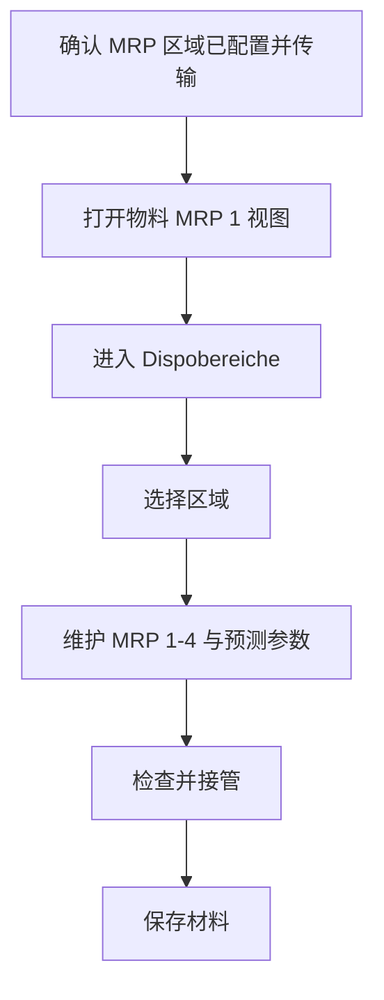

# 在物料主数据中扩展 MRP 区域

> **用途：** 为工厂内特定库存地点或区域维护独立的 Dispobereich 计划参数。  
> **SAP Transaction Code：** `MM01`, `MM02`  
> **来源：** `AZG Dispobereiche im Materialstamm.docx`  
> **状态：** 历史培训资料整理；字段、布局、权限和 Customizing 必须在当前 SAP 系统验证。

## 1. 适用范围与前置条件

- 适用于 ZIEGLER 采购、物料需求计划或采购报表场景。
- 执行前确认公司代码、工厂、采购组织、采购组、物料和权限。
- 涉及数量、交期、供应商分配、MRP 参数或采购统计时，应进行业务负责人复核。

## 2. 流程图

## 3. SAP 页面与字段

| SAP 页面/区域 | 字段或控件 | 填写/选择 | 说明与风险 |
|---|---|---|---|
| MM02 | Sicht | Disposition 1 | 入口视图 |
| Disposition 1 | Dispobereiche | 按钮 | 打开区域总览 |
| Übersicht Dispobereiche | Dispobereich | 例如 M1133 | 工厂 1000 自动有同名区域 1000 |
| Disposition 1 | Dispomerkmal | 例如 VB/PD | 必填 |
| Disposition 1 | Meldebestand / Disponent | 按区域策略 | 可不同于工厂 |
| Disposition 2 | Sonderbeschaffung | 45 | 从工厂向 MRP 区域调拨 |
| Prognose | Vergangenheitsperioden / Prognoseperioden | 按策略 | 仅预测模式需要 |
| Verbrauchswerte | Gesamtverbrauch | 历史数据 | 影响未来采购数量 |
| Footer | Übernehmen | 点击 | 接管区域数据 |

## 4. 详细操作

1. **配置前提**  
   新 MRP 区域需先在 Customizing 客户端 100 建立并传输。工厂本身会自动存在同名 MRP 区域，如 Werk 1000 对应 Dispobereich 1000。
2. **进入物料**  
   新材料可用 `MM01`，已有材料用 `MM02`；选择 Disposition 1。
3. **打开区域**  
   点击 Dispobereiche。若已有区域，`Dispobereich vorhanden` 自动勾选。
4. **新增/选择**  
   从列表选择目标区域；新增更多区域时点击加号。
5. **维护参数**  
   在 Disposition 1-4、Prognose、Verbrauchswerte 中维护独立参数。Dispomerkmal 必填。
6. **特殊采购**  
   如果主要由主工厂补给，可维护 Sonderbeschaffung `45`，MRP 将建议从工厂向区域调拨。
7. **接管保存**  
   先 Prüfen，再点击 Übernehmen 接管区域数据，返回材料主数据后保存。

## 5. 完成检查

- [ ] 输入对象、组织范围和日期范围正确
- [ ] 必填字段完整
- [ ] SAP 状态栏显示保存或执行成功
- [ ] 结果与源凭证/主数据交叉核对
- [ ] 影响采购员、MRP 或报表的变更已通知相关人员

## 6. 待确认与资料限制

- ⚠️ Sonderbeschaffung 45 的含义来自历史配置，必须确认当前工厂间/库存地点调拨设计。
- ⚠️ 资料中的 M1133、G7200、R1122 为示例区域，不能直接用于其他材料。

## 7. 常见风险

- 不要把“显示结果”当作“数据正确”，必须检查选择条件、单位、币种、日期和组织层级。
- 主数据或需求数量变更可能重新打开采购需求，或与已存在的采购订单脱节。
- MRP 区域、特殊采购类型和安全库存会直接影响系统采购建议，应在测试材料上验证后推广。
