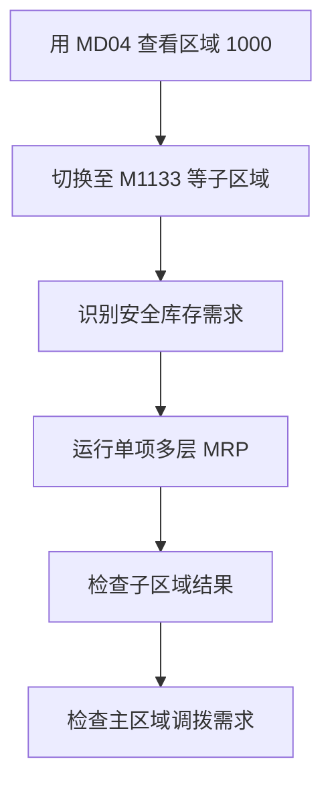

# 检查并运行 MRP 区域计划

> **用途：** 分别检查主工厂区域和子 MRP 区域的库存需求，并运行单项多层计划。  
> **SAP Transaction Code：** `MD04`  
> **来源：** `AZG Dispobereiche im Materialstamm.docx`  
> **状态：** 历史培训资料整理；字段、布局、权限和 Customizing 必须在当前 SAP 系统验证。

## 1. 适用范围与前置条件

- 适用于 ZIEGLER 采购、物料需求计划或采购报表场景。
- 执行前确认公司代码、工厂、采购组织、采购组、物料和权限。
- 涉及数量、交期、供应商分配、MRP 参数或采购统计时，应进行业务负责人复核。

## 2. 流程图

## 3. SAP 页面与字段

| SAP 页面/区域 | 字段或控件 | 填写/选择 | 说明与风险 |
|---|---|---|---|
| MD04 | Material | 材料号 | 示例 A0057840 |
| MD04 | Dispobereich | 1000 或 M1133 | 必须分别检查 |
| Bestands-/Bedarfsliste | Sicherheitsbestand | 需求 | 安全库存可形成需求 |
| Einzelplanung mehrstufig | Verarbeitungsschlüssel | NETCH | 全期间净变化 |
| Planungsparameter | Bestellanf. erstellen | 1 | 按当前规则确认 |
| Planungsparameter | Planungsmodus | 3 | 调整计划数据，需谨慎 |

## 4. 详细操作

1. **主区域基线**  
   输入 `MD04`，填写材料和 Dispobereich 1000，检查库存与需求。
2. **子区域**  
   切换到 M1133 等目标区域。安全库存设置会在该区域显示需求。
3. **运行 MRP**  
   从子区域执行 Einzelplanung mehrstufig，确认 Werk、Dispobereich 和参数后运行。
4. **检查子区域结果**  
   查看生成的采购申请或调拨建议。
5. **检查主区域结果**  
   切回区域 1000；若 Sonderbeschaffung 45 生效，主区域可出现向子区域供货的负需求或 BANF 预测。
6. **业务解释**  
   负数量表示需要向采购申请地址供货，不应简单解释为负库存。

## 5. 完成检查

- [ ] 输入对象、组织范围和日期范围正确
- [ ] 必填字段完整
- [ ] SAP 状态栏显示保存或执行成功
- [ ] 结果与源凭证/主数据交叉核对
- [ ] 影响采购员、MRP 或报表的变更已通知相关人员

## 6. 待确认与资料限制

- ⚠️ 资料未明确单项多层计划的独立事务码，只展示从 MD04 场景进入；当前系统入口需确认。
- ⚠️ 运行 MRP 前应使用测试材料，避免大量真实采购建议。

## 7. 常见风险

- 不要把“显示结果”当作“数据正确”，必须检查选择条件、单位、币种、日期和组织层级。
- 主数据或需求数量变更可能重新打开采购需求，或与已存在的采购订单脱节。
- MRP 区域、特殊采购类型和安全库存会直接影响系统采购建议，应在测试材料上验证后推广。
