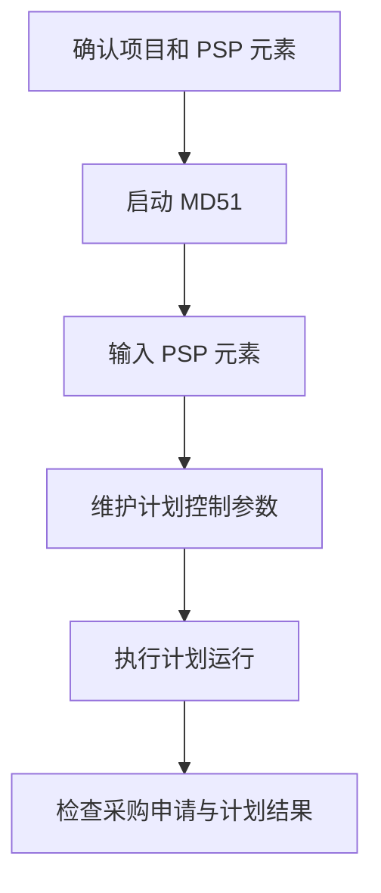

# 手动启动项目 MRP 计划运行

> **用途：** 当项目需求需要短期进入采购计划时，按 PSP 元素手动执行项目级多层计划。  
> **Transaction Code：** `MD51`  
> **来源文件：** `Dispolauf für Projekt manuell anstoßen.docx`  
> **状态：** 历史培训资料整理；字段、权限、组织数据与 Customizing 必须在当前系统验证。

## 1. 适用范围与权限

- 适用于采购、物料计划或工程变更相关岗位。
- 执行人必须具备对应事务、工厂、采购组织及对象的修改权限。
- 影响采购建议、BOM、委外供料、库存或供应商评价的变更，应执行四眼复核。

## 2. 流程图

## 3. 页面与字段

| 页面/区域 | 字段或控件 | 填写/选择 | 说明与风险 |
|---|---|---|---|
| Projektplanung - mehrstufig | Projektdef. | 可留空或按当前系统要求填写 | 资料主要通过 PSP 元素限定项目 |
| Projektplanung - mehrstufig | PSP-Element | 项目 PSP 元素 | 历史示例：00-18-000224 |
| Steuerungsparameter Disposition | Bestellanf. erstellen | 1 | 原则上创建采购申请 |
| Steuerungsparameter Disposition | Planungsmodus | 1 | 调整计划数据，Normalmodus |
| Steuerungsparameter Disposition | Lieferplaneinteilungen | 3 | 原则上创建交货计划行 |
| Steuerungsparameter Disposition | Terminierung | 1 | 按计划订单确定基本日期 |
| Steuerungsparameter Ablauf | Auch unveränderte Komponenten planen | 按需要勾选 | 扩大计划范围 |
| Steuerungsparameter Ablauf | Ergebnisse vor dem Sichern anzeigen | 建议首次运行勾选 | 保存前检查结果 |
| Steuerungsparameter Ablauf | Materialliste anzeigen | 按需勾选 | 显示受影响材料 |

## 4. 详细操作

1. **准备**  
   确认项目、PSP 元素、当前需求和负责 Disponent。
2. **启动**  
   输入 `MD51`。
3. **限定项目**  
   在 PSP-Element 输入项目编号。资料说明该字段用于指定要运行计划的项目。
4. **维护参数**  
   按批准的计划策略输入 Bestellanf. erstellen、Planungsmodus、Lieferplaneinteilungen 和 Terminierung。
5. **安全执行**  
   首次或高风险项目建议勾选 Ergebnisse vor dem Sichern anzeigen，先检查结果再保存。
6. **运行**  
   按 Enter 或执行按钮启动项目多层计划。
7. **结果检查**  
   在项目需求、采购申请清单及库存/需求列表中检查新增计划建议，确认没有重复 BANF。

## 5. 完成检查

- [ ] PSP 元素正确
- [ ] 计划参数符合当前 MRP 策略
- [ ] 结果已在保存前审阅
- [ ] 新增 BANF 数量与日期正确
- [ ] 采购员已获知紧急需求

## 6. 待确认事项

- ⚠️ 原资料仅展示通过 Enter 启动，当前界面可能要求执行按钮或 F8。
- ⚠️ 参数 1/1/3/1 是历史示例，不应未经验证用于所有项目。

## 7. 常见风险

- 系统显示结果不等于业务结果正确，必须核对对象、工厂、有效日期、数量和状态栏消息。
- 不得通过主数据或 BOM 修改绕过采购、工程变更或审批流程。
- 示例材料号、供应商号、项目号和组织值只用于理解页面，不应直接复制到实际业务。
