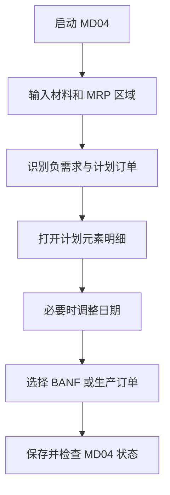

# 在 MD04 中将计划订单转换为 BANF 或生产订单

> **用途：** 在库存需求清单中识别短缺，并把计划订单转换为采购申请或生产订单。  
> **Transaction Code：** `MD04`  
> **来源文件：** `Disposition über md04 und md06.docx`  
> **状态：** 历史培训资料整理；字段、权限、状态码和自定义事务必须在当前系统验证。

## 1. 适用范围与权限

- 适用于物料计划、采购需求处理或输出管理相关岗位。
- 执行人必须具备对应事务、对象和组织范围的显示或修改权限。
- 涉及采购申请转换、消息删除、重新发送和收件人修改时，应保留四眼复核和操作记录。

## 2. 流程图

## 3. 页面与字段

| 页面/区域 | 字段或控件 | 填写/选择 | 说明与风险 |
|---|---|---|---|
| MD04 Einstieg | Material | 材料号 | 示例号不得直接复制 |
| MD04 Einstieg | Dispobereich / Werk | 实际 MRP 区域和工厂 | 限定正确计划范围 |
| Bedarfs-/Bestandsliste | Zugang/Bedarf | 负号为需求/消耗 | 行尾显示当前可用数量 |
| Dispositionselement | Pl-Auf | 双击 | 打开计划订单明细 |
| Details zum Dispositionselement | Eröffnungstermin | 按实际需要调整 | 铅笔图标进入编辑 |
| Details zum Dispositionselement | Eckstarttermin / Bedarfstermin | 按实际日期 | 影响采购或生产时间 |
| Umsetzung | Banf / FertAuftr | 按采购或自制决定 | 不得误选处理路径 |
| Planauftrag umsetzen | Umgesetzte Menge | 待采购数量 | 复核单位 |
| Planauftrag umsetzen | Lieferungen ab/bis | 期望交货日期 | 采购申请交期 |
| Planauftrag umsetzen | Einkäufergruppe | 负责采购组 | 系统主数据建议值 |

## 4. 详细操作

1. **查看供需**  
   输入 `MD04`，填写材料、工厂和 MRP 区域。负数表示需求，行尾可用数量反映逐笔计算后的库存。
2. **识别建议**  
   查找 `Pl-Auf` 计划订单。系统用计划订单覆盖需求，该对象可以转换为生产订单或 BANF。
3. **打开明细**  
   双击 `Pl-Auf`。需要修正时点击铅笔图标，调整 Eröffnungstermin、Eckstarttermin 或 Bedarfstermin。
4. **选择路径**  
   自制件选择 FertAuftr，外购需求选择 `Banf`。转换前核对材料的 Beschaffungsart 和业务责任。
5. **维护 BANF**  
   填写 Umgesetzte Menge、Lieferungen ab/bis，并核对 Disponent 和 Einkäufergruppe。
6. **保存**  
   保存后返回 MD04。原 `Pl-Auf` 应变为 `BS-Anf`；采购员转订单后通常显示 `BS-Ein`。
7. **复核**  
   检查数量、日期和可用量是否按预期变化，避免同一需求重复转换。

## 5. 完成检查

- [ ] 材料、工厂和 MRP 区域正确
- [ ] 计划订单对应真实需求
- [ ] 采购/自制路径正确
- [ ] 转换数量与交期正确
- [ ] 采购组正确
- [ ] MD04 中状态已更新

## 6. 待确认事项

- ⚠️ MD04 缩写和显示文本可能因系统语言、布局或版本变化。

## 7. 常见风险

- 保存、绿色状态灯或生成的凭证号才表示处理完成。
- 批量运行前必须验证筛选条件，避免跨工厂、跨采购组或跨用户处理无关对象。
- 消息输出中的收件人、附件和变更消息标识可能影响供应商沟通，发送前必须复核。
