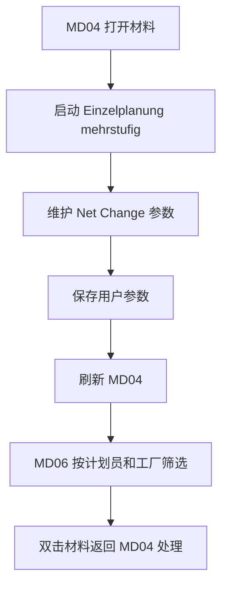

# 运行单项多层 MRP 并使用 MD06 处理计划清单

> **用途：** 对单个材料立即运行 Net Change 计划，并按负责计划员查看需要处理的材料清单。  
> **Transaction Code：** `MD04`, `MD06`  
> **来源文件：** `Disposition über md04 und md06.docx`  
> **状态：** 历史培训资料整理；字段、权限、状态码和自定义事务必须在当前系统验证。

## 1. 适用范围与权限

- 适用于物料计划、采购需求处理或输出管理相关岗位。
- 执行人必须具备对应事务、对象和组织范围的显示或修改权限。
- 涉及采购申请转换、消息删除、重新发送和收件人修改时，应保留四眼复核和操作记录。

## 2. 流程图

## 3. 页面与字段

| 页面/区域 | 字段或控件 | 填写/选择 | 说明与风险 |
|---|---|---|---|
| MD04 Toolbar | Einzelplanung mehrstufig | 点击 | 启动单物料多层计划 |
| Einzelplanung mehrstufig | Verarbeitungsschlüssel | NETCH 或当前 Net Change 参数 | 仅计划净变化对象 |
| Planungsparameter | Bestellanf. erstellen | 按当前策略 | 决定是否直接创建 BANF |
| Planungsparameter | Planungsmodus | 按当前策略 | 影响计划数据重建方式 |
| Menü > Einstellungen | Sichern | 保存当前选择 | 通常只需为用户设置一次 |
| MD06 Einstieg | Disponent | 本人计划员代码 | 历史示例为 F08 |
| MD06 Einstieg | Werk | 负责工厂 | 只处理本人责任工厂 |
| MD06 Einstieg | Betrachtungshorizont | 日期或其他范围 | 缩小工作清单 |

## 4. 详细操作

1. **单项计划**  
   在 `MD04` 点击 `Einzelplanung mehrstufig`。
2. **维护参数**  
   选择 Net Change 处理键，并设置创建 BANF、计划模式和计划范围等参数。
3. **保存参数**  
   通过 Menü > Einstellungen > Sichern 保存个人选择。首次设置后无需每次重复。
4. **执行刷新**  
   执行计划后刷新 MD04，确认 BANF、计划订单或日期变化已经显示。
5. **工作清单**  
   输入 `MD06`，填写本人 Disponent、负责工厂及 Betrachtungshorizont，然后执行。
6. **处理异常**  
   结果显示需要计划员处理的材料。双击材料号跳转至 `MD04`。
7. **采取措施**  
   在 MD04 中按需求创建 BANF、生产订单或调整计划元素，并记录异常原因。

## 5. 完成检查

- [ ] Net Change 参数符合当前规则
- [ ] 没有误选全量重算
- [ ] 个人参数已保存
- [ ] MD04 已刷新
- [ ] MD06 只包含本人负责范围
- [ ] 异常材料已逐项处理

## 6. 待确认事项

- ⚠️ 源文件截图未提取出 Net Change 参数的完整值，本文不补猜；必须按当前系统模板确认。
- ⚠️ MD06 清单计算通常通过执行按钮/F8，而不是单纯 Enter，需实机确认。

## 7. 常见风险

- 保存、绿色状态灯或生成的凭证号才表示处理完成。
- 批量运行前必须验证筛选条件，避免跨工厂、跨采购组或跨用户处理无关对象。
- 消息输出中的收件人、附件和变更消息标识可能影响供应商沟通，发送前必须复核。
