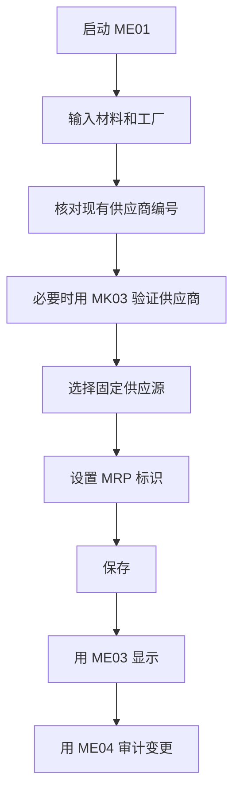

# 维护材料货源清单与固定供应源

> **用途：** 为材料和工厂维护供应商、合同及有效期，并指定固定供应源和 MRP 相关标识。  
> **Transaction Code：** `ME01`, `ME03`, `ME04`, `MK03`  
> **来源文件：** `Orderbuch pflegen.docx`  
> **状态：** 历史资料整理；字段、有效期、消息类型、处理媒介和自定义配置必须在当前系统验证。

## 1. 适用范围与权限

- 适用于货源清单、采购信息记录价格调整和经典消息控制。
- 固定供应源、价格批量变更及 NACE 条件记录均属高影响配置，应执行四眼复核并保留变更证据。
- 示例公司、人员、供应商、材料、价格、订单和组织编号不写入匿名化流程。

## 2. 流程图

## 3. 页面与字段

| 页面/区域 | 字段或控件 | 填写/选择 | 说明与风险 |
|---|---|---|---|
| ME01 Einstieg | Material | 材料号 | 确认目标材料 |
| ME01 Einstieg | Werk | 目标工厂 | 货源清单按工厂维护 |
| Orderbuch Übersicht | Gültig ab / Gültig bis | 有效日期区间 | 避免重叠或间断 |
| Orderbuch Übersicht | Lieferant | 供应商号 | 页面可能不显示名称 |
| Orderbuch Übersicht | Einkaufsorganisation | 采购组织 | 必须与供应商和材料扩展一致 |
| Orderbuch Übersicht | Vertrag / Position | 合同号/项目 | 如引用合同 |
| Orderbuch Übersicht | Fix | 勾选 | 固定供应源 |
| Orderbuch Übersicht | Dis | 1 或当前 MRP 标识 | 使货源对 MRP 相关 |
| MK03 | Kreditor | 供应商号 | 只读核对供应商身份 |
| ME03 | Material / Werk | 显示 | 不可修改 |
| ME04 | Material / Werk / Änderer / Datum | 审计筛选 | 查看旧值、新值与修改人 |

## 4. 详细操作

1. **入口**  
   输入 `ME01`，填写材料和工厂，按 Enter 进入货源清单。
2. **核对候选**  
   系统按存在的采购信息记录或合同显示供应商行。由于清单可能只显示供应商号，可复制供应商号到 `MK03` 核对名称和组织数据。
3. **固定供应源**  
   在目标供应商行勾选 `Fix`。同一有效期间原则上只保留一个固定供应源，除非业务规则明确允许。
4. **MRP 标识**  
   在 `Dis` 中维护当前系统批准的 MRP 相关值。历史示例为 `1`，使用前必须验证。
5. **有效期**  
   检查 Gültig ab/bis。固定分配发生切换时，应以前一天结束旧记录、从新日期开始新记录，避免重叠。
6. **保存**  
   保存货源清单。
7. **显示**  
   用 `ME03` 只读检查最终状态。
8. **审计**  
   用 `ME04` 按材料、工厂、修改人或日期范围查看变更，并记录旧值、新值、时间和操作人。

## 5. 完成检查

- [ ] 材料和工厂正确
- [ ] 供应商身份已核对
- [ ] 有效期无重叠
- [ ] 固定供应源唯一且有依据
- [ ] MRP 标识符合当前配置
- [ ] 保存成功
- [ ] ME03 显示正确
- [ ] ME04 变更可追踪

## 6. 待确认事项

- ⚠️ Dispokennzeichen 1 为历史配置，不直接认定为当前固定值。
- ⚠️ S/4HANA 中货源确定可能同时受配额、合同、信息记录和 MRP 设置影响。

## 7. 常见风险

- 有效期重叠会产生多个同时有效的供应源或价格条件。
- 删除或重新生成货源清单记录可能丢失固定供应源和 MRP 标识。
- 消息控制条件记录错误会造成未发送、重复发送或发送到错误渠道。
