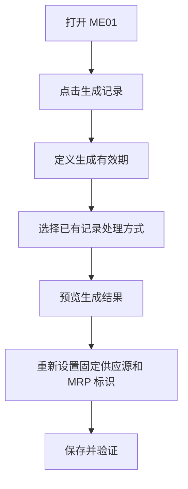

# 从信息记录或合同生成货源清单记录

> **用途：** 在新建采购信息记录或合同后，将候选供应源加载到货源清单，并安全处理已有记录。  
> **Transaction Code：** `ME01`  
> **来源文件：** `Orderbuch pflegen.docx`  
> **状态：** 历史资料整理；字段、有效期、消息类型、处理媒介和自定义配置必须在当前系统验证。

## 1. 适用范围与权限

- 适用于货源清单、采购信息记录价格调整和经典消息控制。
- 固定供应源、价格批量变更及 NACE 条件记录均属高影响配置，应执行四眼复核并保留变更证据。
- 示例公司、人员、供应商、材料、价格、订单和组织编号不写入匿名化流程。

## 2. 流程图

## 3. 页面与字段

| 页面/区域 | 字段或控件 | 填写/选择 | 说明与风险 |
|---|---|---|---|
| ME01 Toolbar | Sätze erzeugen | 点击 | 加载新信息记录或合同 |
| Gültigkeitszeitraum | Gültig ab | 开始日期 | 可立即或未来生效 |
| Gültigkeitszeitraum | Gültig bis | 结束日期 | 按合同/信息记录有效期 |
| Erzeugungsart | nicht verändert | 保留旧记录并新增 | 可能造成同时有效记录 |
| Erzeugungsart | gelöscht | 删除旧记录后重建 | 会丢失固定供应源和 MRP 分配 |
| Erzeugungsart | im Erzeugungszeitraum ungültig | 旧记录在生成期前截止 | 适合切换，但仍需重设新记录标识 |
| Orderbuch Übersicht | Fix / Dis | 重新检查 | 生成后可能为空 |
| Orderbuch Übersicht | Neue Zeile | 手工输入 | 可手工建立单条记录 |

## 4. 详细操作

1. **生成入口**  
   在 `ME01` 进入材料与工厂货源清单，点击 `Sätze erzeugen`。
2. **有效期**  
   定义新记录的 Gültig ab/bis，可立即生效或未来切换。
3. **处理旧记录**  
   选择三种方式之一：`nicht verändert` 保留旧记录并新增；`gelöscht` 删除全部旧记录后重建；`im Erzeugungszeitraum ungültig` 使旧记录在新期间前失效。
4. **风险判断**  
   如果选择 nicht verändert，必须检查旧记录和新记录是否同时有效；如果选择 gelöscht，原 Fix/Dis 分配会丢失。
5. **生成**  
   确认选择并生成新记录。
6. **重新分配**  
   在新记录上重新设置 Fix 和 Dis，尤其是删除或失效旧记录的场景。
7. **手工补充**  
   也可以在空白行手工创建记录，但必须完整维护供应商、组织、有效期和合同引用。
8. **验证**  
   用 ME03 检查，并在 BANF/MRP 测试中确认系统正确确定供应源。

## 5. 完成检查

- [ ] 生成有效期正确
- [ ] 旧记录处理方式经过复核
- [ ] 无同时有效的冲突记录
- [ ] Fix/Dis 已重新设置
- [ ] 合同和供应商引用正确
- [ ] BANF/MRP 测试通过

## 6. 待确认事项

- ⚠️ 源文件显示“删除”会清除 Dispositionszuordnung，批量使用前必须导出或截图备份。

## 7. 常见风险

- 有效期重叠会产生多个同时有效的供应源或价格条件。
- 删除或重新生成货源清单记录可能丢失固定供应源和 MRP 标识。
- 消息控制条件记录错误会造成未发送、重复发送或发送到错误渠道。
