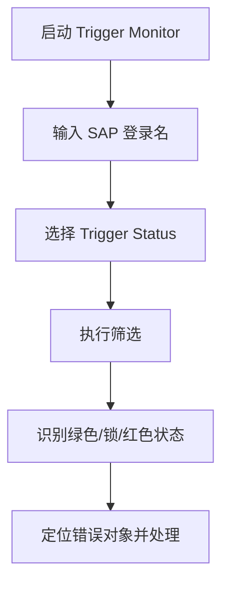

# 监控 DOM Trigger 处理状态

> **用途：** 检查已创建的输出事件是否成功处理、仍在审批或发生错误。  
> **Transaction Code：** `/JA41/M_DOM_MON_TRG`  
> **来源文件：** `DOM Bearbeitung Trigger + Vorrat.docx`  
> **状态：** 历史培训资料整理；字段、权限、状态码和自定义事务必须在当前系统验证。

## 1. 适用范围与权限

- 适用于物料计划、采购需求处理或输出管理相关岗位。
- 执行人必须具备对应事务、对象和组织范围的显示或修改权限。
- 涉及采购申请转换、消息删除、重新发送和收件人修改时，应保留四眼复核和操作记录。

## 2. 流程图

## 3. 页面与字段

| 页面/区域 | 字段或控件 | 填写/选择 | 说明与风险 |
|---|---|---|---|
| DOM Trigger-Monitor | Angelegt von | SAP 登录用户名 | 没有默认值，必须手工输入 |
| DOM Trigger-Monitor | Trigger-Status | 2 | 历史资料中 2=错误处理 |
| DOM Trigger-Monitor | Objektschlüssel | 凭证对象键 | 可定位订单或询价 |
| DOM Trigger-Monitor | Nachrichtenart / Auftragsart | 按需筛选 | 缩小消息类型 |
| DOM Trigger-Monitor Ergebnis | Ampel grün | 成功 | 消息已处理 |
| DOM Trigger-Monitor Ergebnis | Schloss | 审批中 | 消息尚未最终处理 |
| DOM Trigger-Monitor Ergebnis | Ampel rot | 错误 | 需要检查处理日志 |

## 4. 详细操作

1. **启动**  
   输入 `/JA41/M_DOM_MON_TRG`。
2. **用户筛选**  
   在 Angelegt von 输入自己的 SAP 登录名，不是显示姓名。
3. **状态筛选**  
   只查错误消息时将 Trigger-Status 设为 `2`；必要时加入日期、对象键和消息类型。
4. **执行**  
   点击 Ausführen/F8。
5. **解释结果**  
   绿灯表示成功，锁表示仍在审批链，红灯表示错误。消息类型列可区分订单、询价等输出。
6. **处理**  
   对红灯记录打开处理日志或相关凭证，修正收件人、消息控制、审批或技术错误后重新触发。

## 5. 完成检查

- [ ] SAP 登录名正确
- [ ] 状态和日期范围合理
- [ ] 红灯记录均有处理结论
- [ ] 锁状态未被误判为错误
- [ ] 对象键与业务凭证一致

## 6. 待确认事项

- ⚠️ 自定义事务和状态码 2 的含义必须确认当前版本仍一致。

## 7. 常见风险

- 保存、绿色状态灯或生成的凭证号才表示处理完成。
- 批量运行前必须验证筛选条件，避免跨工厂、跨采购组或跨用户处理无关对象。
- 消息输出中的收件人、附件和变更消息标识可能影响供应商沟通，发送前必须复核。
