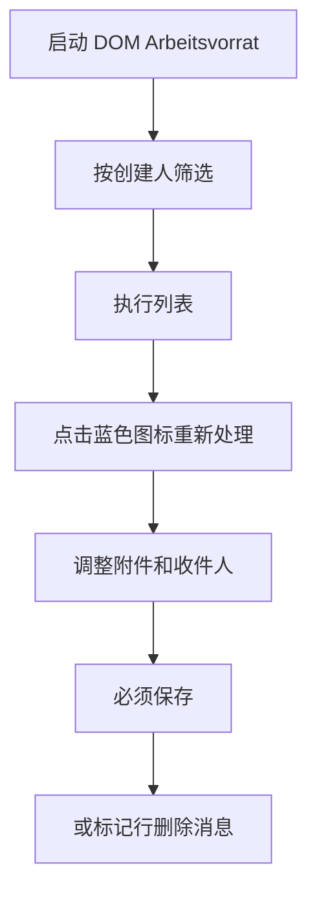

# 处理和删除 DOM 工作列表消息

> **用途：** 查看尚未处理的输出消息，重新打开输出对话、调整附件或收件人，或删除未处理的输出。  
> **Transaction Code：** `/JA41/M_DOM_WORKLIST`  
> **来源文件：** `DOM Bearbeitung Trigger + Vorrat.docx`  
> **状态：** 历史培训资料整理；字段、权限、状态码和自定义事务必须在当前系统验证。

## 1. 适用范围与权限

- 适用于物料计划、采购需求处理或输出管理相关岗位。
- 执行人必须具备对应事务、对象和组织范围的显示或修改权限。
- 涉及采购申请转换、消息删除、重新发送和收件人修改时，应保留四眼复核和操作记录。

## 2. 流程图

## 3. 页面与字段

| 页面/区域 | 字段或控件 | 填写/选择 | 说明与风险 |
|---|---|---|---|
| DOM - Arbeitsvorrat | Angelegt von | SAP 登录用户名 | 必须手工输入 |
| DOM - Arbeitsvorrat | Objekttyp / Externer Objektschlüssel | 按需筛选 | 定位具体业务凭证 |
| Ergebnisliste | 蓝色图标 | 点击 | 重新打开输出处理 |
| Bearbeitungsdialog | Dokumente | 选择附件 | 只发送必要附件 |
| Bearbeitungsdialog | Empfänger | 维护邮箱 | 复核供应商/内部收件人 |
| Menü Bearbeiten | alle Mark. Löschen | 删除已标记输出 | 不删除采购订单和审批流程 |

## 4. 详细操作

1. **启动**  
   输入 `/JA41/M_DOM_WORKLIST`。
2. **筛选**  
   在 Angelegt von 输入 SAP 登录名，并按需要添加对象类型、对象键或日期。
3. **执行**  
   运行工作列表，查看尚未发送或仍在审批的输出。
4. **重新处理**  
   点击行首蓝色图标，重新进入输出对话。选择要发送的文档，并维护额外或替代收件人。
5. **强制保存**  
   即使没有修改任何数据，也必须保存。否则此次输出处理会被丢弃，不会发送消息。再次保存不会生成两条重复的 DOM 消息。
6. **删除输出**  
   若要直接取消消息，单击整行而不是蓝色图标，再选择 Bearbeiten > alle Mark. Löschen。
7. **影响确认**  
   删除只影响该 DOM 输出，采购订单和相应审批流程保持不变。

## 5. 完成检查

- [ ] 筛选到正确用户和凭证
- [ ] 附件与收件人已复核
- [ ] 重新处理后已保存
- [ ] 删除时仅选择目标消息
- [ ] 采购订单和审批状态已抽样确认

## 6. 待确认事项

- ⚠️ 删除菜单文字可能因系统语言或版本不同。

## 7. 常见风险

- 保存、绿色状态灯或生成的凭证号才表示处理完成。
- 批量运行前必须验证筛选条件，避免跨工厂、跨采购组或跨用户处理无关对象。
- 消息输出中的收件人、附件和变更消息标识可能影响供应商沟通，发送前必须复核。
