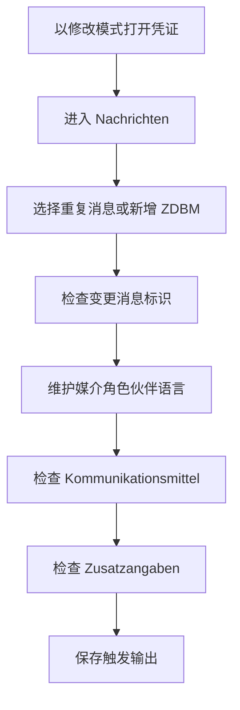

# 重复发送或手工创建 DOM 输出消息

> **用途：** 从采购订单或询价的消息管理中重复既有输出，或手工新增 ZDBM 输出消息。  
> **Transaction Code：** `ME22N`, `ME42`  
> **来源文件：** `DOM Nachrichtenausgabe SAP.docx`  
> **状态：** 历史培训资料整理；字段、权限、状态码和自定义事务必须在当前系统验证。

## 1. 适用范围与权限

- 适用于物料计划、采购需求处理或输出管理相关岗位。
- 执行人必须具备对应事务、对象和组织范围的显示或修改权限。
- 涉及采购申请转换、消息删除、重新发送和收件人修改时，应保留四眼复核和操作记录。

## 2. 流程图

## 3. 页面与字段

| 页面/区域 | 字段或控件 | 填写/选择 | 说明与风险 |
|---|---|---|---|
| Beleg ändern | Nachrichten / Druckersymbol | 点击 | 进入消息管理 |
| Nachrichtenübersicht | Nachricht wiederholen | 点击 | 重复选中消息 |
| Nachrichtenübersicht | Änderungsnachricht Ä | 勾选或空白 | 勾选=变更消息；空白=当前完整凭证 |
| Nachrichtenübersicht | Nachrichtenart | ZDBM | 历史 DOM 消息类型 |
| Nachrichtenübersicht | Medium | 1 Druckausgabe | 历史设置 |
| Nachrichtenübersicht | Rolle | BA | 伙伴角色 |
| Nachrichtenübersicht | Partner | 供应商号 | 必须与凭证供应商一致 |
| Nachrichtenübersicht | Sprache | DE 或供应商语言 | 按实际沟通语言 |
| Kommunikationsmittel | Logische Destination | LOCL | 历史设置 |
| Kommunikationsmittel | Sofort ausgeben | 邮件输出不勾选 | 手工打印场景勾选 |
| Zusatzangaben | Versandzeitpunkt | 4 sofort versenden | 保存应用时立即发送 |

## 4. 详细操作

1. **打开凭证**  
   必须以修改模式打开采购订单或询价，例如 `ME22N` 或 `ME42`，再进入 Nachrichten。
2. **重复消息**  
   标记目标消息并选择 Nachricht wiederholen。
3. **区分变更消息**  
   如果 Ä 列勾选，重复的是 Änderungsnachricht。若要发送包含全部修改的当前完整凭证，应选择没有 Ä 标记的行。
4. **手工创建**  
   在空白行输入消息类型 `ZDBM`、Medium `1 Druckausgabe`、Rolle `BA`、Partner 和 Sprache。
5. **通信设置**  
   只对当前选中行打开 Kommunikationsmittel。维护 Logische Destination `LOCL`；邮件 DOM 不勾选 Sofort ausgeben。
6. **附加设置**  
   打开 Zusatzangaben，将 Versandzeitpunkt 设为 `4 sofort versenden`。
7. **保存**  
   保存凭证。保存动作创建并触发新的输出消息。
8. **特殊供应商**  
   没有默认消息控制的通用供应商，需要手工创建 DOM，并在 DOM 邮件对话框中手工填写邮箱。

## 5. 完成检查

- [ ] 凭证处于修改模式
- [ ] 选中的消息行正确
- [ ] Ä 标识含义已确认
- [ ] ZDBM/Medium/Rolle/Partner/语言正确
- [ ] 通信和发送时间已检查
- [ ] 保存后消息状态已验证

## 6. 待确认事项

- ⚠️ ZDBM、BA、LOCL 和发送时点 4 均为历史配置，必须按当前输出管理确认。
- ⚠️ 历史通用供应商编号不再写入流程，避免错误复用。

## 7. 常见风险

- 保存、绿色状态灯或生成的凭证号才表示处理完成。
- 批量运行前必须验证筛选条件，避免跨工厂、跨采购组或跨用户处理无关对象。
- 消息输出中的收件人、附件和变更消息标识可能影响供应商沟通，发送前必须复核。
