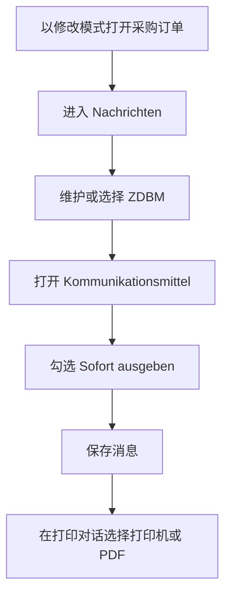

# 手工打印或生成 PDF 的 DOM 输出

> **用途：** 通过消息管理立即调用打印对话，选择实体打印机或 PDF 输出。  
> **Transaction Code：** `ME22N`  
> **来源文件：** `DOM Nachrichtenausgabe SAP.docx`  
> **状态：** 历史培训资料整理；字段、权限、状态码和自定义事务必须在当前系统验证。

## 1. 适用范围与权限

- 适用于物料计划、采购需求处理或输出管理相关岗位。
- 执行人必须具备对应事务、对象和组织范围的显示或修改权限。
- 涉及采购申请转换、消息删除、重新发送和收件人修改时，应保留四眼复核和操作记录。

## 2. 流程图

## 3. 页面与字段

| 页面/区域 | 字段或控件 | 填写/选择 | 说明与风险 |
|---|---|---|---|
| Nachrichtenübersicht | Nachrichtenart | ZDBM 或当前有效类型 | 按输出配置 |
| Nachrichtenübersicht | Medium | 1 Druckausgabe | 打印输出 |
| Kommunikationsmittel | Logische Destination | LOCL | 历史设置 |
| Kommunikationsmittel | Sofort ausgeben | 勾选 | 与邮件发送场景相反 |
| Drucken | Name | 实体打印机或 PDFCreator/PDF 设备 | 选择获批设备 |
| Drucken | Druckbereich | Alles / Seiten / Markierung | 按需要 |
| Drucken | Anzahl Exemplare | 份数 | 避免重复打印 |

## 4. 详细操作

1. **打开**  
   用 `ME22N` 以修改模式打开采购订单并进入 Nachrichten。
2. **消息行**  
   选择既有消息或手工维护消息类型、媒介、伙伴和语言。
3. **通信设置**  
   在 Kommunikationsmittel 中输入 `LOCL`，并勾选 `Sofort ausgeben`。
4. **保存**  
   保存消息，系统弹出打印对话。
5. **输出**  
   选择实体打印机或批准的 PDF 虚拟打印机，确认页范围和份数。
6. **替代方式**  
   也可使用普通 DOM 邮件输出，把收件人改为自己的邮箱，以获得电子副本。

## 5. 完成检查

- [ ] 消息行与凭证正确
- [ ] Sofort ausgeben 已勾选
- [ ] 打印机/PDF 设备正确
- [ ] 页范围和份数正确
- [ ] 输出文件或纸张已检查

## 6. 待确认事项

- ⚠️ 源文件截图包含旧网络打印路径，匿名化版本不保留该路径；应使用当前批准的设备。

## 7. 常见风险

- 保存、绿色状态灯或生成的凭证号才表示处理完成。
- 批量运行前必须验证筛选条件，避免跨工厂、跨采购组或跨用户处理无关对象。
- 消息输出中的收件人、附件和变更消息标识可能影响供应商沟通，发送前必须复核。
