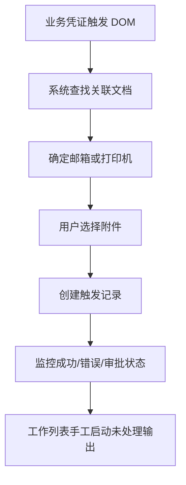

# DOM 功能范围、监控入口与状态判断

> **用途：** 理解文档输出管理的功能范围、监控菜单、触发记录状态和工作列表处理入口。  
> **Transaction Code：** `/JA41/M_DOM_MON_TRG`, `/JA41/M_DOM_WORKLIST`  
> **来源文件：** `DOM Schulung.docx`  
> **状态：** 历史培训资料整理；字段、权限、状态码、自定义对象和金额阈值必须在当前系统验证。

## 1. 适用范围与权限

- 适用于采购、主数据、审批策略或输出管理相关岗位。
- 修改分类、特征、审批人、金额边界或输出规则属于高风险配置，应在开发/测试系统验证并执行四眼复核。
- 生产系统变更必须有变更单、测试证据、回退方案和审批记录。

## 2. 流程图

## 3. 页面与字段

| 页面/区域 | 字段或控件 | 填写/选择 | 说明与风险 |
|---|---|---|---|
| DOM 功能 | Mailen/Faxen/Drucken/Ablegen | 按业务规则 | 支持业务凭证和关联文档 |
| DOM 功能 | Dokumentauswahl | 勾选/取消附件 | 发送前预选 |
| DOM 功能 | E-Mail-Adresse | 自动确定 | 仍需人工复核 |
| DOM 功能 | Drucker | 自动确定 | 按工厂/场景配置 |
| SAP Menü > Monitoring | /JA41/M_DOM_MON_TRG | DOM Trigger-Monitor | 监控触发记录 |
| SAP Menü > DOM Direkt | /JA41/M_DOM_WORKLIST | DOM Arbeitsvorrat | 处理未完成消息 |
| Trigger Monitor | DOM-Prozess | 例如 Z/JA41/MM_PORDER_MAIL | 订单邮件处理流程 |
| Trigger Monitor | Nachrichtenart | ZDAE/ZDBM/ZDKM 等历史类型 | 按当前配置核对 |
| Trigger Monitor Ergebnis | 绿色状态 | 成功 | 可打开协议查看步骤 |
| Trigger Monitor Ergebnis | 锁图标 | 审批未完成 | 不能误判成技术错误 |
| Trigger Monitor Ergebnis | 红色/中止 | 失败 | 查看协议中的中止步骤 |
| Arbeitsvorrat | Start 图标 | 点击 | 未自动发送时手工启动 |

## 4. 详细操作

1. **了解范围**  
   DOM 可以为采购订单、报价、生产订单等业务凭证自动查找关联文件，并支持邮件、传真、打印或归档。
2. **附件控制**  
   系统可在预选对话中显示关联文件，用户决定哪些附件发送或打印。
3. **监控入口**  
   在菜单 Monitoring und Alerting 中打开 Trigger Monitor；在 DOM Direkt 中打开 Arbeitsvorrat。
4. **筛选 Trigger**  
   按创建人、对象键、DOM-Prozess、消息类型和日期筛选。
5. **判断状态**  
   绿色为成功；锁表示等待审批；红色或协议中出现 Abbruch 表示失败。
6. **查看协议**  
   打开触发记录协议，逐步检查服务启动、原件查找、PDF 合并、存档和邮件动作。
7. **处理工作列表**  
   尚未处理的消息进入 Arbeitsvorrat。点击 Start 图标手工启动，否则邮件可能不会发送。
8. **复核**  
   手工启动后返回 Trigger Monitor，确认新记录成功，不保留重复未处理项。

## 5. 完成检查

- [ ] 业务凭证和对象键正确
- [ ] 附件选择合理
- [ ] 邮箱和打印机已复核
- [ ] 触发记录状态正确解释
- [ ] 错误协议已定位中止步骤
- [ ] 工作列表启动后已验证结果

## 6. 待确认事项

- ⚠️ 资料提到 DIN A0-A8、盖章、拆分、合并和 PDF 转换可能不在基础交付范围，当前许可与配置需确认。
- ⚠️ 培训材料中的供应商标识和菜单品牌不保留在匿名化知识库。

## 7. 常见风险

- 错误的分类值或边界会导致凭证无法进入审批、进入错误策略，或被错误人员批准。
- 自定义输出消息重新启动、删除或重发前，必须核对凭证、收件人、附件和审批状态。
- 历史示例编号仅用于说明，不应直接复制到当前系统。
