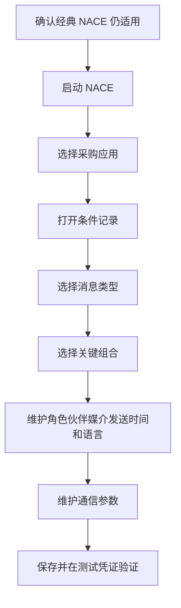

# 配置经典采购消息控制条件记录

> **用途：** 按采购应用、消息类型、凭证类型、采购组织和供应商维护消息确定、发送媒介、发送时间和通信参数。  
> **Transaction Code：** `NACE`  
> **来源文件：** `Nachrichtensteuerung Einstellungen.docx`  
> **状态：** 历史资料整理；字段、有效期、消息类型、处理媒介和自定义配置必须在当前系统验证。

## 1. 适用范围与权限

- 适用于货源清单、采购信息记录价格调整和经典消息控制。
- 固定供应源、价格批量变更及 NACE 条件记录均属高影响配置，应执行四眼复核并保留变更证据。
- 示例公司、人员、供应商、材料、价格、订单和组织编号不写入匿名化流程。

## 2. 流程图

## 3. 页面与字段

| 页面/区域 | 字段或控件 | 填写/选择 | 说明与风险 |
|---|---|---|---|
| NACE | Applikation EA | 询价消息 | 询价、提醒、拒绝 |
| NACE | Applikation EF | 采购消息 | 订单、退货、计划协议、订单确认/交期催收、变更 |
| NACE | Applikation EV | 合同消息 | 合同及合同确认催收 |
| NACE | Applikation MR | 发票校验消息 | 例如自动结算差异通知 |
| NACE Toolbar | Konditionssätze | 点击 | 进入消息条件记录 |
| Nachrichtenart | 消息类型 | 按当前配置 | 不要复制历史 Z 类型 |
| Schlüsselkombination | Einkaufsorg./Lieferant | EDI 或特定组织供应商 | 内部系统传输场景 |
| Schlüsselkombination | Belegart/Einkaufsorg./Lieferant | 供应商例外 | 单一供应商特殊规则 |
| Schlüsselkombination | Belegart | 凭证类型通用 | 适用于全部符合凭证类型 |
| Konditionssatz | Rolle / Partner | 伙伴角色/伙伴 | 例如订购地址角色，按当前规则 |
| Konditionssatz | Medium | 1 / 5 / 6 | 1 打印/DOM；5 外部发送；6 EDI |
| Konditionssatz | Zeitpunkt | 1 / 2 / 3 / 4 | 夜间、指定时间、完成后、立即发送 |
| Konditionssatz | Sprache | 供应商语言 | 影响表单语言 |
| Kommunikation | Ausgabegerät | LOCL 或当前设备 | DOM 历史设置 |
| Kommunikation | Sofort ausgeben | DOM 邮件时不勾选 | 手工打印场景另行处理 |

## 4. 详细操作

1. **适用性**  
   确认系统仍使用经典 NACE。S/4HANA 新 Output Management 不一定使用该事务。
2. **应用**  
   输入 `NACE`，选择 EA、EF、EV 或 MR 等目标应用。
3. **条件记录**  
   点击 Konditionssätze，并选择需要维护的消息类型。
4. **关键组合**  
   选择采购组织+供应商、凭证类型+采购组织+供应商，或仅凭证类型。选择越具体，优先级通常越高。
5. **消息数据**  
   维护伙伴角色、伙伴、媒介、发送时点、语言和有效期。
6. **媒介**  
   Medium 1 用于打印/DOM，5 用于外部邮件，6 用于 EDI。实际含义必须按当前系统确认。
7. **发送时点**  
   1/2 通常为批处理，3 为凭证完成后，4 为立即发送且通常在审批后生效。
8. **通信**  
   在 Kommunikation 页签维护输出设备。DOM 历史设置使用 LOCL 且不勾选 Sofort ausgeben。
9. **保存**  
   保存条件记录并记录变更请求。
10. **测试**  
   创建测试询价、订单、退货或合同，验证消息确定、审批后触发、接收人、语言和处理协议。

## 5. 完成检查

- [ ] 系统确实使用 NACE
- [ ] 目标应用和消息类型正确
- [ ] 关键组合没有过宽
- [ ] 伙伴和语言正确
- [ ] 媒介和发送时点符合业务
- [ ] DOM/打印通信设置正确
- [ ] 测试凭证消息确定成功
- [ ] 处理协议无错误

## 6. 待确认事项

- ⚠️ 历史消息类型、采购组织和供应商例外均未写入 Repository。
- ⚠️ NACE 条件记录变更建议先在测试系统验证并通过传输管理上线。

## 7. 常见风险

- 有效期重叠会产生多个同时有效的供应源或价格条件。
- 删除或重新生成货源清单记录可能丢失固定供应源和 MRP 标识。
- 消息控制条件记录错误会造成未发送、重复发送或发送到错误渠道。
