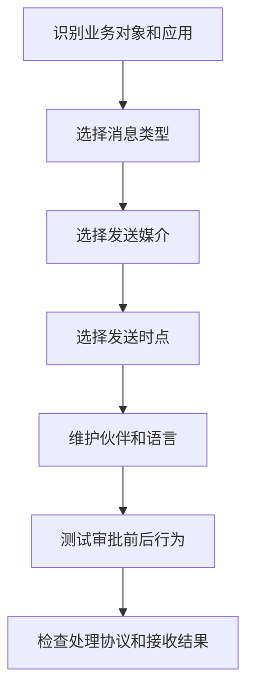

# 采购消息媒介与发送时点参考

> **用途：** 提供经典消息控制中发送媒介和时点的业务含义及测试检查表。  
> **Transaction Code：**   
> **来源文件：** `Nachrichtensteuerung Einstellungen.docx`  
> **状态：** 历史资料整理；字段、有效期、消息类型、处理媒介和自定义配置必须在当前系统验证。

## 1. 适用范围与权限

- 适用于货源清单、采购信息记录价格调整和经典消息控制。
- 固定供应源、价格批量变更及 NACE 条件记录均属高影响配置，应执行四眼复核并保留变更证据。
- 示例公司、人员、供应商、材料、价格、订单和组织编号不写入匿名化流程。

## 2. 流程图

## 3. 页面与字段

| 页面/区域 | 字段或控件 | 填写/选择 | 说明与风险 |
|---|---|---|---|
| Sendemedium | 1 Druckausgabe | 打印或 DOM 入口 | 可发送到本地输出或文档管理 |
| Sendemedium | 5 Externes Senden | 外部邮件 | 地址通常来自供应商主数据 |
| Sendemedium | 6 EDI | 系统到系统传输 | 适用于已配置接口的内部/外部伙伴 |
| Versandzeitpunkt | 1 | 夜间处理 | 由批处理运行发送 |
| Versandzeitpunkt | 2 | 夜间后指定时点 | 依赖批处理计划 |
| Versandzeitpunkt | 3 | 凭证完成后 | 允许在最终输出前修改凭证 |
| Versandzeitpunkt | 4 | 立即发送 | 通常最迟在审批完成后触发 |
| DOM Kommunikation | Ausgabegerät LOCL | 历史设置 | 不勾选 Sofort ausgeben |
| Test | Nachrichtenübersicht / Protokoll | 检查 | 确认只生成一次正确消息 |

## 4. 详细操作

1. **对象**  
   确认是询价、订单、退货、计划协议、合同、催收还是自动结算通知。
2. **媒介**  
   打印/DOM 场景选择当前对应媒介；外部邮件使用外部发送；系统接口使用 EDI。
3. **时点**  
   需要批准后立即发送时选择当前配置的立即时点；需要集中批处理时选择夜间时点。
4. **伙伴**  
   检查伙伴角色、供应商/接收系统和语言。
5. **测试**  
   分别测试创建、修改、审批前、审批后和重复输出。
6. **防重复**  
   检查相同凭证不会同时被 DOM、外部邮件和 EDI 重复发送。
7. **协议**  
   检查消息状态、处理时间、接收人和错误协议。

## 5. 完成检查

- [ ] 业务对象正确
- [ ] 媒介与伙伴能力匹配
- [ ] 发送时点符合审批要求
- [ ] 语言正确
- [ ] 没有重复消息
- [ ] 审批后触发符合预期
- [ ] 处理协议成功

## 6. 待确认事项

- ⚠️ 媒介和时点编号来自经典消息控制，当前系统可能不同。
- ⚠️ 具体应用与消息类型映射应维护在配置清单，不硬编码在流程。

## 7. 常见风险

- 有效期重叠会产生多个同时有效的供应源或价格条件。
- 删除或重新生成货源清单记录可能丢失固定供应源和 MRP 标识。
- 消息控制条件记录错误会造成未发送、重复发送或发送到错误渠道。
