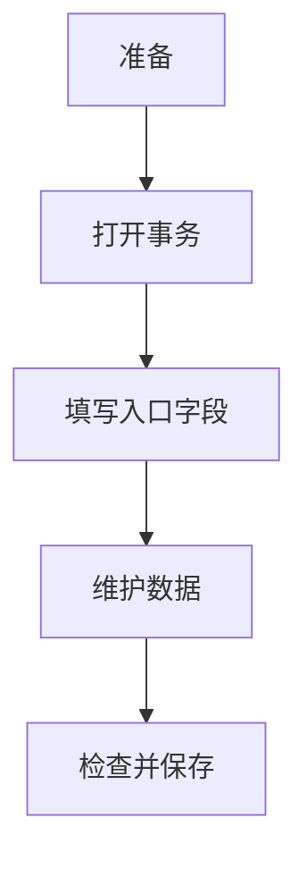

# 创建变更号

> **用途：** 创建变更主记录作为材料、BOM 和文档变更的控制对象  
> **SAP Transaction Code：** `CC01`  
> **来源：** `2018_09_13_PDM_Handbuch_gesamt.pdf`  
> **状态：** 从历史培训资料整理，执行前须在当前 SAP 系统验证字段、权限和组织数据。

## 1. 前置条件

- 已获得相应 SAP 权限
- 输入对象、组织数据和变更号已准备

## 2. 流程图

## 3. 页面与字段填写

| SAP 页面/区域 | 字段或控件 | 填写/选择 | 注意事项 |
|---|---|---|---|
| CC01 Einstieg | Profil | YB01 | 历史资料指定 |
| Änderungsstamm | Gültig ab | 实际生效日期 | 影响后续对象 |
| Änderungsstamm | Änderungsgrund | Neuanlage/Änderung | 描述清晰 |
| Änderungsstamm | Status | 05 | 构造处理中；08 为送审 |

## 4. 详细操作

1. **启动**  
   输入 `CC01`。
2. **入口**  
   输入 Profil `YB01` 并继续。
3. **主数据**  
   填写有效日期、变更原因，状态设为 05。
4. **保存**  
   保存并从状态栏记录生成的变更号。

## 5. 完成检查

- [ ] 入口对象正确
- [ ] 必填字段无遗漏
- [ ] 状态/有效日期正确
- [ ] 保存消息成功
- [ ] 生成号或变更记录已保存

## 6. 常见风险

- 不要把“能显示”误认为“已保存”，必须确认 SAP 状态栏出现成功消息和生成的单据号。
- 如果字段与本文不一致，优先检查事务代码、凭证类型、组织层级、用户权限和 SAP 版本。
- 涉及价格、库存、会计凭证、放行或删除标识时，遵循四眼原则和公司权限矩阵。
