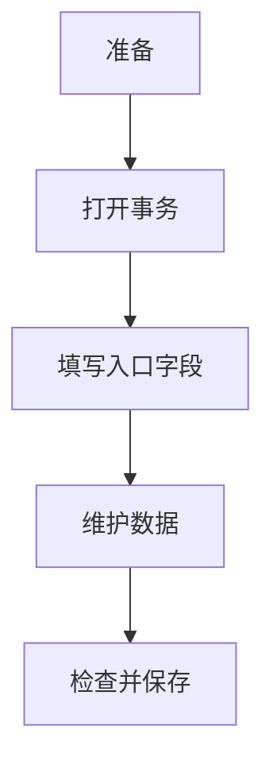

# 创建材料

> **用途：** 创建材料主数据并维护基础、分类及英文描述  
> **SAP Transaction Code：** `MM01`  
> **来源：** `2018_09_13_PDM_Handbuch_gesamt.pdf`  
> **状态：** 从历史培训资料整理，执行前须在当前 SAP 系统验证字段、权限和组织数据。

## 1. 前置条件

- 已获得相应 SAP 权限
- 输入对象、组织数据和变更号已准备

## 2. 流程图

## 3. 页面与字段填写

| SAP 页面/区域 | 字段或控件 | 填写/选择 | 注意事项 |
|---|---|---|---|
| MM01 Einstieg | Änderungsnummer | 已创建 ECN | 先使用 CC01 |
| Sichtenauswahl | Grunddaten 1/2/Klassifizierung | 选择 | 按需要扩展 |
| Grunddaten 1 | Kurztext/Langtext | 德文描述 | 准确且可搜索 |
| Grunddaten 1 | Basismengeneinheit/Sparte/Status/Gewicht | 实际值 | 重量单位必须匹配 |
| Zusatzdaten | Sprache EN | 英文短文本/长文本 | 返回主数据后再保存 |

## 4. 详细操作

1. **启动**  
   输入 `MM01` 并填写变更号。
2. **选择视图**  
   至少选择 Grunddaten 1、Grunddaten 2、Klassifizierung。
3. **维护数据**  
   填写描述、基本单位、产品组/部门、状态、净重和重量单位。
4. **英文描述**  
   打开 Zusatzdaten，选择 EN，维护英文短文本和长文本。
5. **保存**  
   保存并记录新材料号。

## 5. 完成检查

- [ ] 入口对象正确
- [ ] 必填字段无遗漏
- [ ] 状态/有效日期正确
- [ ] 保存消息成功
- [ ] 生成号或变更记录已保存

## 6. 常见风险

- 不要把“能显示”误认为“已保存”，必须确认 SAP 状态栏出现成功消息和生成的单据号。
- 如果字段与本文不一致，优先检查事务代码、凭证类型、组织层级、用户权限和 SAP 版本。
- 涉及价格、库存、会计凭证、放行或删除标识时，遵循四眼原则和公司权限矩阵。
