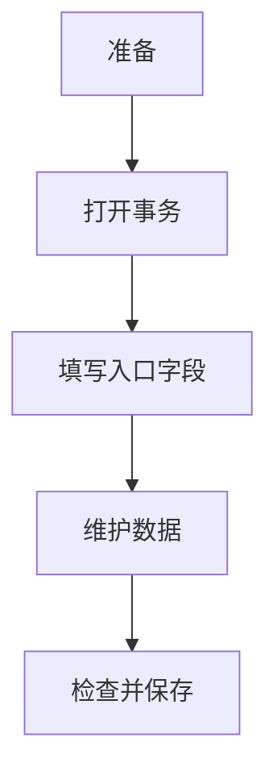

# 创建或修改 BOM

> **用途：** 创建或修改材料 BOM  
> **SAP Transaction Code：** `CS01`, `CS02`  
> **来源：** `2018_09_13_PDM_Handbuch_gesamt.pdf`  
> **状态：** 从历史培训资料整理，执行前须在当前 SAP 系统验证字段、权限和组织数据。

## 1. 前置条件

- 已获得相应 SAP 权限
- 输入对象、组织数据和变更号已准备

## 2. 流程图

## 3. 页面与字段填写

| SAP 页面/区域 | 字段或控件 | 填写/选择 | 注意事项 |
|---|---|---|---|
| CS01/CS02 Einstieg | Material | 头材料号 | 集团级材料时 Werk 可留空，按现行规则确认 |
| Einstieg | Änderungsnummer | ECN | 变更必须可追溯 |
| Positionsübersicht | Positionstyp | L 或 T | L 库存位置，T 文本位置 |
| Positionsübersicht | Komponente | 组件材料号 | 检查有效性 |
| Positionsübersicht | Menge / ME | 数量/单位 | 单位与材料主数据一致 |

## 4. 详细操作

1. **启动**  
   新建用 `CS01`，修改用 `CS02`。
2. **入口**  
   填写头材料、用途、替代 BOM、变更号及组织字段。
3. **头数据**  
   检查 BOM 状态和有效日期。
4. **位置**  
   按 0010/0020 等位置输入类型、组件、数量和单位。
5. **修改场景**  
   CS02 可追加、插入、删除位置或调整数量。
6. **保存**  
   保存并检查消息列表。

## 5. 完成检查

- [ ] 入口对象正确
- [ ] 必填字段无遗漏
- [ ] 状态/有效日期正确
- [ ] 保存消息成功
- [ ] 生成号或变更记录已保存

## 6. 常见风险

- 不要把“能显示”误认为“已保存”，必须确认 SAP 状态栏出现成功消息和生成的单据号。
- 如果字段与本文不一致，优先检查事务代码、凭证类型、组织层级、用户权限和 SAP 版本。
- 涉及价格、库存、会计凭证、放行或删除标识时，遵循四眼原则和公司权限矩阵。
