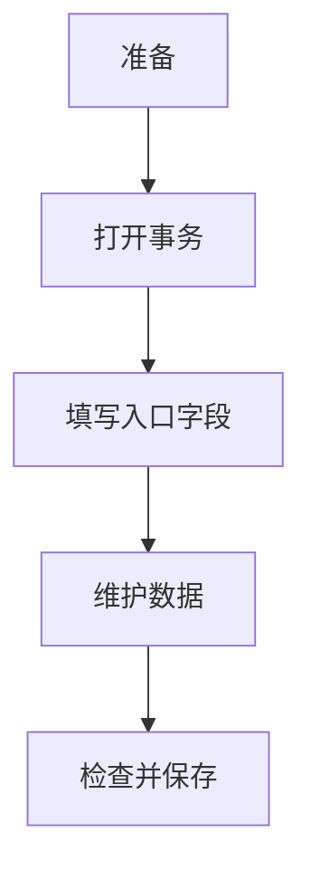

# 修改文档与材料链接

> **用途：** 修改 DIS、管理原件、材料链接、状态、版本和权限  
> **SAP Transaction Code：** `CV02N`  
> **来源：** `2018_09_13_PDM_Handbuch_gesamt.pdf`  
> **状态：** 从历史培训资料整理，执行前须在当前 SAP 系统验证字段、权限和组织数据。

## 1. 前置条件

- 已获得相应 SAP 权限
- 输入对象、组织数据和变更号已准备

## 2. 流程图

## 3. 页面与字段填写

| SAP 页面/区域 | 字段或控件 | 填写/选择 | 注意事项 |
|---|---|---|---|
| CV02N Einstieg | Dokumentart/Dokumentnummer/Teil/Version | 文档标识 | 注意不是材料号 |
| Dokumentdaten | Status | IA/FR 等 | 先切换到编辑模式 |
| Objektverknüpfung | Material | 材料号 | 建立或解除链接 |
| Originale | Original | 文件 | 可新增、删除、显示 |
| Berechtigungen | Benutzer/Rechte | 按需要 | 保密将限制其他用户 |

## 4. 详细操作

1. **启动**  
   输入 `CV02N`，填写文档类型、文档号、部分和版本。
2. **修改文档**  
   在 Dokumentdaten 维护描述或状态。
3. **材料链接**  
   在 Objektverknüpfung 输入材料号；删除该行可解除链接。
4. **原件**  
   在 Originale 添加、替换或删除文件。
5. **版本与权限**  
   仅在批准状态规则允许时生成新版本；保密操作须谨慎。
6. **保存**  
   保存并用 `CV03N`/`MM03` 验证链接。

## 5. 完成检查

- [ ] 入口对象正确
- [ ] 必填字段无遗漏
- [ ] 状态/有效日期正确
- [ ] 保存消息成功
- [ ] 生成号或变更记录已保存

## 6. 常见风险

- 不要把“能显示”误认为“已保存”，必须确认 SAP 状态栏出现成功消息和生成的单据号。
- 如果字段与本文不一致，优先检查事务代码、凭证类型、组织层级、用户权限和 SAP 版本。
- 涉及价格、库存、会计凭证、放行或删除标识时，遵循四眼原则和公司权限矩阵。
