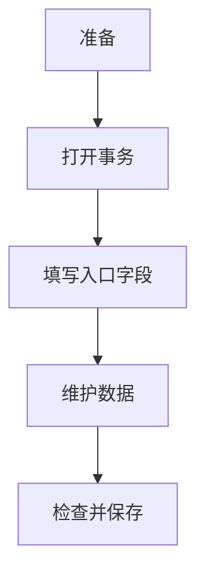

# 显示与搜索文档

> **用途：** 按精确标识显示文档或用条件搜索文档  
> **SAP Transaction Code：** `CV03N`, `CV04N`  
> **来源：** `2018_09_13_PDM_Handbuch_gesamt.pdf`  
> **状态：** 从历史培训资料整理，执行前须在当前 SAP 系统验证字段、权限和组织数据。

## 1. 前置条件

- 已获得相应 SAP 权限
- 输入对象、组织数据和变更号已准备

## 2. 流程图

## 3. 页面与字段填写

| SAP 页面/区域 | 字段或控件 | 填写/选择 | 注意事项 |
|---|---|---|---|
| CV03N | Dokumentart/Dokumentnummer/Teil/Version | 完整文档键 | 无文档类型时改用 CV04N |
| CV04N | Dokumentnummer | 完整号或含 * | 可用通配符 |
| Suchergebnis | Dokument | 双击/选择 | 可从结果进入显示或修改 |

## 4. 详细操作

1. **精确显示**  
   用 `CV03N` 输入完整文档键。
2. **查看内容**  
   在 Dokumentdaten、Objektverknüpfung、Originale 查看数据和文件。
3. **模糊搜索**  
   用 `CV04N` 输入已知条件，可在文档号中使用 `*`。
4. **执行**  
   点击执行并从结果进入目标文档。

## 5. 完成检查

- [ ] 入口对象正确
- [ ] 必填字段无遗漏
- [ ] 状态/有效日期正确
- [ ] 保存消息成功
- [ ] 生成号或变更记录已保存

## 6. 常见风险

- 不要把“能显示”误认为“已保存”，必须确认 SAP 状态栏出现成功消息和生成的单据号。
- 如果字段与本文不一致，优先检查事务代码、凭证类型、组织层级、用户权限和 SAP 版本。
- 涉及价格、库存、会计凭证、放行或删除标识时，遵循四眼原则和公司权限矩阵。
