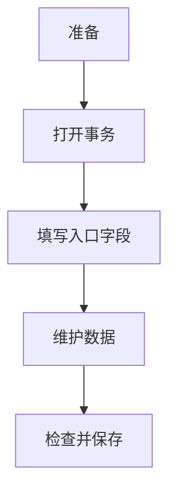

# 显示与搜索材料

> **用途：** 查看材料主数据、附加数据和关联文档  
> **SAP Transaction Code：** `MM03`  
> **来源：** `2018_09_13_PDM_Handbuch_gesamt.pdf`  
> **状态：** 从历史培训资料整理，执行前须在当前 SAP 系统验证字段、权限和组织数据。

## 1. 前置条件

- 已获得相应 SAP 权限
- 输入对象、组织数据和变更号已准备

## 2. 流程图

## 3. 页面与字段填写

| SAP 页面/区域 | 字段或控件 | 填写/选择 | 注意事项 |
|---|---|---|---|
| MM03 Einstieg | Material | 材料号或搜索帮助 | 可用 *关键词* |
| Sichtenauswahl | Grunddaten | 所需视图 | 勾选后确认 |
| Zusatzdaten | Dokumente/Grunddatentext/Prüftext | 显示 | 文档可用眼镜按钮打开 |

## 4. 详细操作

1. **启动**  
   输入 `MM03`。
2. **搜索**  
   未知材料号时用搜索帮助，输入 `*关键词*`，从结果确认。
3. **选择视图**  
   选择 Grunddaten 或其他所需视图。
4. **附加数据**  
   打开 Zusatzdaten 查看描述、单位、EAN、文档和文本。

## 5. 完成检查

- [ ] 入口对象正确
- [ ] 必填字段无遗漏
- [ ] 状态/有效日期正确
- [ ] 保存消息成功
- [ ] 生成号或变更记录已保存

## 6. 常见风险

- 不要把“能显示”误认为“已保存”，必须确认 SAP 状态栏出现成功消息和生成的单据号。
- 如果字段与本文不一致，优先检查事务代码、凭证类型、组织层级、用户权限和 SAP 版本。
- 涉及价格、库存、会计凭证、放行或删除标识时，遵循四眼原则和公司权限矩阵。
