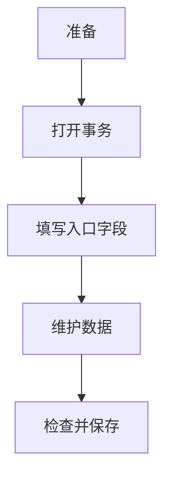

# 材料主数据工作流

> **用途：** 按变更号状态驱动集团与工厂部门处理  
> **SAP Transaction Code：** `CC02`, `CC07`  
> **来源：** `2018_09_13_PDM_Handbuch_gesamt.pdf`  
> **状态：** 从历史培训资料整理，执行前须在当前 SAP 系统验证字段、权限和组织数据。

## 1. 前置条件

- 已获得相应 SAP 权限
- 输入对象、组织数据和变更号已准备

## 2. 流程图

## 3. 页面与字段填写

| SAP 页面/区域 | 字段或控件 | 填写/选择 | 注意事项 |
|---|---|---|---|
| CC07 | Statusfilter | 所需状态 | 定位待处理 ECN |
| CC02 | Status | 05→08→10 | 构造完成、标准化审核、集团分发 |
| Werkworkflow | Status | 01→11→12→13→14→15→16→17→18 | AV、采购、物流、销售、出口、质量、核算、放行 |

## 4. 详细操作

1. **监控**  
   用 `CC07` 按状态筛选并打开变更号对象。
2. **构造提交**  
   对象完整后用 `CC02` 将 05 改为 08。
3. **标准化**  
   审核后改为 10，触发各工厂流程。
4. **工厂处理**  
   各部门维护自己的视图并按顺序推进状态。
5. **最终放行**  
   所有视图完成后状态到 18。

## 5. 完成检查

- [ ] 入口对象正确
- [ ] 必填字段无遗漏
- [ ] 状态/有效日期正确
- [ ] 保存消息成功
- [ ] 生成号或变更记录已保存

## 6. 常见风险

- 不要把“能显示”误认为“已保存”，必须确认 SAP 状态栏出现成功消息和生成的单据号。
- 如果字段与本文不一致，优先检查事务代码、凭证类型、组织层级、用户权限和 SAP 版本。
- 涉及价格、库存、会计凭证、放行或删除标识时，遵循四眼原则和公司权限矩阵。
