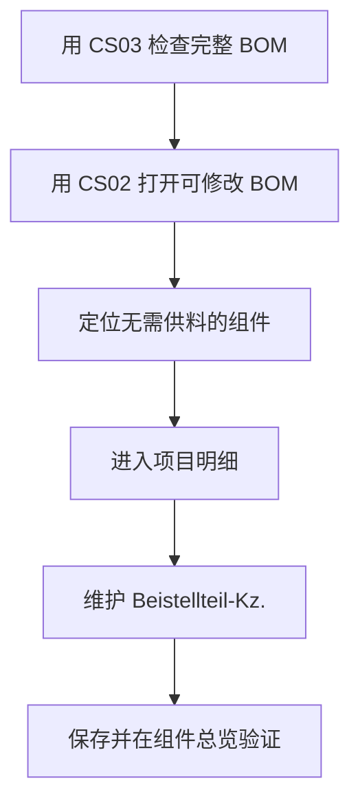

# 维护委外供料 BOM 项目标识

> **用途：** 通过 BOM 项目字段控制哪些组件由采购方供料，哪些组件由供应商自行提供。  
> **Transaction Code：** `CS02`, `CS03`  
> **来源文件：** `Bestellung mit Beistellung Stammdatenpflege FERTIG.docx`  
> **状态：** 历史培训资料整理；字段、权限、组织数据与 Customizing 必须在当前系统验证。

## 1. 适用范围与权限

- 适用于采购、物料计划或工程变更相关岗位。
- 执行人必须具备对应事务、工厂、采购组织及对象的修改权限。
- 影响采购建议、BOM、委外供料、库存或供应商评价的变更，应执行四眼复核。

## 2. 流程图

## 3. 页面与字段

| 页面/区域 | 字段或控件 | 填写/选择 | 说明与风险 |
|---|---|---|---|
| CS02/CS03 Einstieg | Material | 被采购组件/装配件材料号 | 确认对象 |
| CS02/CS03 Einstieg | Werk | 实际工厂 | 历史示例为 1000 |
| CS02/CS03 Einstieg | Verwendung | 3 | 通用/生产 BOM 用途的历史示例 |
| Positionsübersicht | Positionsnummer | 双击 | 打开项目明细 |
| Position > Status/Langtext | Beistellteil-Kz. | L 或空白 | L=供应商自行提供，不由采购方供料；空白=经典供料组件 |

## 4. 详细操作

1. **显示检查**  
   用 `CS03` 查看完整 BOM，识别委外加工所需全部组件。
2. **进入修改**  
   用 `CS02` 打开相同材料、工厂、用途和替代 BOM。
3. **项目明细**  
   双击目标项目号，打开 Position: Alle Daten。
4. **设置标识**  
   在 Status/Langtext 的 `Beistellteil-Kz.` 输入 `L`，表示该组件由供应商提供，因此不作为采购方供料组件。字段留空表示需要发给供应商。
5. **逐项处理**  
   对每个不需要外发的 BOM 项目重复设置。
6. **保存验证**  
   保存后，在订单组件总览检查项目编号是否从实际需要供料的首个项目开始。

## 5. 完成检查

- [ ] 每个 BOM 项目均完成供料责任判断
- [ ] L 与空白的含义没有反向理解
- [ ] 材料、工厂、用途和替代 BOM 正确
- [ ] 保存后组件总览符合预期

## 6. 待确认事项

- ⚠️ 该标识名称容易误解：资料明确说明 `L` 表示供应商供料，采购方不外发。当前系统字段帮助仍应再次核对。

## 7. 常见风险

- 系统显示结果不等于业务结果正确，必须核对对象、工厂、有效日期、数量和状态栏消息。
- 不得通过主数据或 BOM 修改绕过采购、工程变更或审批流程。
- 示例材料号、供应商号、项目号和组织值只用于理解页面，不应直接复制到实际业务。
