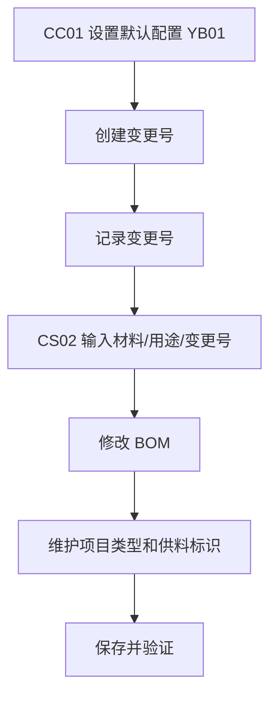

# 使用变更号修改委外供料 BOM

> **用途：** 先创建工程变更号，再在有效日期控制下替换、新增或删除委外供料 BOM 组件。  
> **Transaction Code：** `CC01`, `CS02`  
> **来源文件：** `Bestellung mit Beistellung Stückliste ändern.docx`  
> **状态：** 历史培训资料整理；字段、权限、组织数据与 Customizing 必须在当前系统验证。

## 1. 适用范围与权限

- 适用于采购、物料计划或工程变更相关岗位。
- 执行人必须具备对应事务、工厂、采购组织及对象的修改权限。
- 影响采购建议、BOM、委外供料、库存或供应商评价的变更，应执行四眼复核。

## 2. 流程图

## 3. 页面与字段

| 页面/区域 | 字段或控件 | 填写/选择 | 说明与风险 |
|---|---|---|---|
| CC01 > Einstellungen > Vorschlagswerte | Profil | YB01 | 可保存为以后默认值 |
| CC01 Einstieg | Profil | YB01 | 进入变更主记录 |
| Änderungskopf | Kurztext | BOM 变更原因 | 清晰描述变更对象 |
| Änderungskopf | Gültig ab | 当天或批准的生效日 | 决定 BOM 版本生效时间 |
| Änderungskopf | Änderungsgrund | 补充原因 | 用于追溯 |
| Änderungskopf | Status Änderungsnr | 01 | 激活状态的历史示例 |
| CS02 Einstieg | Material | 需修改的装配件 | 确认正确材料 |
| CS02 Einstieg | Verwendung | 3 | 历史示例 |
| CS02 Einstieg | Änderungsnummer | CC01 生成的号码 | 必须准确复制 |
| Positionsübersicht | Komponente | 新材料号 | 替换原号码或新增 |
| Positionsübersicht | Positionstyp | L | 库存项目的历史示例 |
| Positionsübersicht | Menge | 每采购单位所需数量 | 核对单位 |
| Position > Status/Langtext | Beistellteil-Kz. | L 或空白 | L=供应商提供；空白=采购方外发 |

## 4. 详细操作

1. **默认设置**  
   在 `CC01` 通过 Menü > Einstellungen > Vorschlagswerte，把 Profil 设置为 `YB01` 并接管。
2. **创建变更号**  
   进入变更头，填写短文本、Gültig ab、Änderungsgrund，并把状态设为 `01`。保存。
3. **记录编号**  
   从状态栏消息中复制系统生成的 Änderungsnummer，避免手工抄写错误。
4. **进入 BOM**  
   输入 `CS02`，填写材料、工厂、Verwendung `3` 和变更号。
5. **对象描述**  
   在对象管理窗口填写此次 BOM 变更描述并确认。
6. **替换组件**  
   直接用新材料号覆盖 Komponente；复核数量、单位和项目类型。
7. **新增或删除**  
   新增项目时填写 Komponente、Positionstyp `L` 和数量；删除必须确认有效日期和后续订单影响。
8. **供料责任**  
   打开项目明细，在 Status/Langtext 维护 Beistellteil-Kz.。`L` 表示供应商提供，空白表示由采购方供料。
9. **保存验证**  
   保存 BOM，用未来有效日期显示或订单组件总览验证变更结果。

## 5. 完成检查

- [ ] 变更号生效日期正确
- [ ] 变更原因可追溯
- [ ] 材料替换没有误改相似项目
- [ ] 新增数量和单位正确
- [ ] 供料责任标识正确
- [ ] 保存后按有效日期验证 BOM

## 6. 待确认事项

- ⚠️ 状态 01、Profil YB01、用途 3 是历史设计，当前 ECM 状态模型与 BOM 用途需确认。
- ⚠️ 删除或替换组件可能影响开放采购订单和生产订单，需在变更前做 where-used 检查。

## 7. 常见风险

- 系统显示结果不等于业务结果正确，必须核对对象、工厂、有效日期、数量和状态栏消息。
- 不得通过主数据或 BOM 修改绕过采购、工程变更或审批流程。
- 示例材料号、供应商号、项目号和组织值只用于理解页面，不应直接复制到实际业务。
