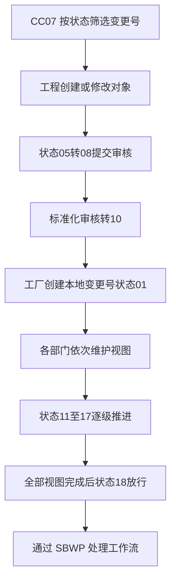

# 执行材料主数据工程变更工作流

> **用途：** 通过活动监控、变更号状态和跨部门工作流完成材料、BOM 与文档的创建、审核及工厂级放行。  
> **Transaction Code：** `CC07`, `CC02`, `SBWP`  
> **来源文件：** `SAP_Kurzbedienung Workflow.pdf`  
> **状态：** 历史资料整理；字段、状态、命名规则与工作流必须在当前系统验证。

## 1. 适用范围与权限

- 适用于标准文本、工程变更工作流或采购凭证查询。
- 多语言文本、工程变更状态和跨部门工作流均可能影响外部输出或主数据放行，应执行四眼复核。
- 示例公司、人员、地点、材料、凭证和组织编号不写入匿名化流程。

## 2. 流程图

## 3. 页面与字段

| 页面/区域 | 字段或控件 | 填写/选择 | 说明与风险 |
|---|---|---|---|
| CC07 | Status | 当前待办状态 | 筛选活动监控清单 |
| CC07 | Änderungsnummer | 打开 | 进入材料/BOM/文档对象 |
| CC02 | Status 05 | 工程处理中 | 新建/修改开始 |
| CC02 | Status 08 | 工程完成待审核 | 提交标准化审核 |
| CC02 | Status 10 | 标准化审核完成 | 触发各工厂工作流 |
| CC02 | Status 01 | 工厂本地变更号初始状态 | 历史工厂流程 |
| CC02 | Status 11 | 工艺/工作准备完成 | 部门视图已维护 |
| CC02 | Status 12 | 采购完成 | 采购视图已维护 |
| CC02 | Status 13 | 物流完成 | 物流视图已维护 |
| CC02 | Status 14 | 销售完成 | 销售视图已维护 |
| CC02 | Status 15 | 出口完成 | 出口视图已维护 |
| CC02 | Status 16 | 质量完成 | 质量视图已维护 |
| CC02 | Status 17 | 成本核算完成 | 成本视图已维护 |
| CC02 | Status 18 | 材料最终放行 | 所有必要视图完成 |
| SBWP | Workflow Inbox | 部门工作项 | 按角色处理 |

## 4. 详细操作

1. **活动监控**  
   用 `CC07` 按状态、变更号和对象范围筛选。双击变更号进入相关材料、BOM 或文档。
2. **工程阶段**  
   工程完成创建或修改后，将变更号从状态 `05` 改为 `08`，表示提交审核。
3. **标准化审核**  
   审核通过后转为 `10`，触发工厂级工作流。
4. **工厂启动**  
   工厂处理使用新的本地变更号，历史初始状态为 `01`。状态 `10` 的集团变更号不继续复用。
5. **部门处理**  
   各部门维护自己的材料主数据视图、BOM 或文档，并将状态依次推进。
6. **采购阶段**  
   前一状态为 `11` 时，采购维护采购、MRP、信息记录或其他批准字段，并推进至 `12`。
7. **完整性**  
   物流、销售、出口、质量和成本核算按本地责任依次推进至 `17`。
8. **最终放行**  
   确认所有必要视图完成、无错误和缺失后，将状态改为 `18`。
9. **工作流入口**  
   工作项通常按部门发送到指定人员，也可在 `SBWP` 查看。状态跳过仅在获批例外时使用。

## 5. 完成检查

- [ ] CC07 选中正确变更号
- [ ] 工程对象完整
- [ ] 05→08 审核提交正确
- [ ] 08→10 审核有证据
- [ ] 工厂使用正确本地变更号
- [ ] 各部门视图完成后才推进状态
- [ ] 采购状态12有采购复核
- [ ] 状态18前所有视图完整
- [ ] 工作流无未处理项

## 6. 待确认事项

- ⚠️ 状态 01、05、08、10-18 是历史自定义状态，必须与当前 ECM 工作流核对。
- ⚠️ 状态跳过属于例外，不作为标准流程。

## 7. 常见风险

- 标准文本缺少目标语言时，输出凭证可能完全不打印该文本。
- 工程变更状态跳转可能绕过部门维护和验证，不得无审批跳过。
- 查询结果取决于筛选条件、组织范围和布局，必须抽查凭证明细。
