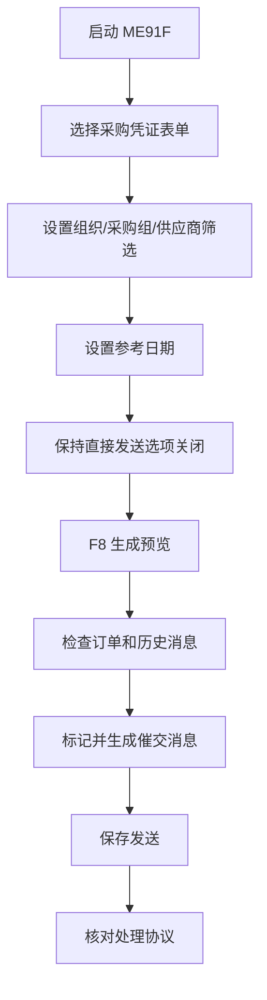

# 催交逾期或即将到期采购订单

> **用途：** 筛选开放采购凭证，逐项检查后生成、修改、取消或发送催交通知。  
> **Transaction Code：** `ME91F`  
> **来源文件：** `Mahnwesen.docx`  
> **状态：** 历史资料整理；字段、组织值、价格导入、消息输出与主数据默认值必须在当前系统验证。

## 1. 适用范围与权限

- 适用于材料扩展、采购催交和采购信息记录批量条件维护。
- 材料估价、采购条件批量导入和催交通知均属高影响操作，应执行四眼复核。
- 示例公司、人员、供应商、材料、订单和组织编号不写入匿名化流程。

## 2. 流程图

## 3. 页面与字段

| 页面/区域 | 字段或控件 | 填写/选择 | 说明与风险 |
|---|---|---|---|
| ME91F Auswahl | Auswählen | Bestellung / Lieferplan / Anfrage 等 | 只选择需要的凭证类型 |
| Selektionsbild | Einkaufsbeleg / Einkaufsorganisation / Einkäufergruppe | 按业务范围 | 避免全量运行 |
| Selektionsbild | Lieferant / Belegdatum / Lieferdatum | 进一步限定 | 供应商和日期范围 |
| Parameter | Bezugsdatum | 逾期测量基准日 | 过去日期=只看更早到期；未来日期=预防性催交 |
| Parameter | Nachrichten erzeugen und sichern | 保持不勾选 | 勾选后 F8 可能直接批量发送 |
| Ergebnisliste | Zeilenauswahl | 勾选 | 仅选择需催交订单 |
| Ergebnisliste | Nachrichten erzeugen | 点击 | 创建黄色未处理消息 |
| Nachrichtenübersicht | gelbe Ampel | 未处理消息 | 可在保存前删除取消 |
| Nachrichtenübersicht | Kommunikationsmittel | 检查收件人 | 确保正确邮箱/媒介 |
| Nachrichtenübersicht | Verarbeitungsprotokoll | 检查处理 | 发送后留痕 |

## 4. 详细操作

1. **入口**  
   输入 `ME91F`，点击 Auswählen，选择应纳入的采购凭证类型。
2. **筛选**  
   维护采购组织、采购组、供应商、采购凭证和日期等范围。
3. **参考日期**  
   使用 Bezugsdatum 定义逾期基准。向过去移动可只显示早已逾期订单；向未来移动可做预防性催交。
4. **安全选项**  
   不要勾选 Nachrichten erzeugen und sichern，以免 F8 后无预览直接批量发送。
5. **执行**  
   按 F8 显示候选订单。
6. **审查**  
   双击订单查看约定、确认记录和历史沟通；通过 Nachrichten 查看已发送催交通知数量。
7. **生成**  
   标记需催交的行，点击 Nachrichten erzeugen。
8. **取消**  
   如需撤销未发送消息，打开 Nachrichten，选择黄灯未处理行，点击垃圾桶并保存。列表可能仍显示 Nachricht erzeugt，但消息不会发送。
9. **发送**  
   最终检查后保存，系统向已维护地址发送消息。
10. **留痕**  
   在消息概览中检查时间、接收人、通信媒介和处理协议。

## 5. 完成检查

- [ ] 筛选范围正确
- [ ] 参考日期符合催交策略
- [ ] 直接批量发送选项未勾选
- [ ] 订单历史沟通已检查
- [ ] 收件人正确
- [ ] 选中行正确
- [ ] 消息保存并成功处理
- [ ] 发送记录可追溯

## 6. 待确认事项

- ⚠️ 采购价值键中的催交天数会影响候选结果，需与材料主数据核对。
- ⚠️ 输出可能已迁移到新的消息管理。

## 7. 常见风险

- 量产或批量操作前先使用少量测试对象，并保存导出文件和处理日志。
- 不要使用历史截图中的组织值、价格、材料状态或联系人。
- 批量消息发送前不得勾选跳过预览的选项。
