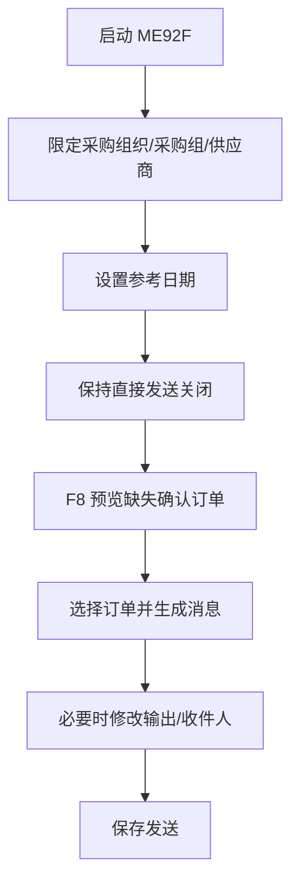

# 催收缺失的订单确认

> **用途：** 按约定确认期限筛选缺失订单确认的采购订单，人工审查后生成并发送催收消息。  
> **Transaction Code：** `ME92F`  
> **来源文件：** `Mahnwesen.docx`  
> **状态：** 历史资料整理；字段、组织值、价格导入、消息输出与主数据默认值必须在当前系统验证。

## 1. 适用范围与权限

- 适用于材料扩展、采购催交和采购信息记录批量条件维护。
- 材料估价、采购条件批量导入和催交通知均属高影响操作，应执行四眼复核。
- 示例公司、人员、供应商、材料、订单和组织编号不写入匿名化流程。

## 2. 流程图

## 3. 页面与字段

| 页面/区域 | 字段或控件 | 填写/选择 | 说明与风险 |
|---|---|---|---|
| ME92F Auswahl | Einkaufsbeleg / Einkaufsorganisation | 范围 | 按负责组织 |
| ME92F Auswahl | Einkäufergruppe / Lieferant / Belegdatum | 范围 | 按采购员或供应商 |
| Parameter | Bezugsdatum | 确认逾期基准 | 应减去供应商获准的确认天数 |
| Parameter | Nachrichten erzeugen und sichern | 保持不勾选 | 否则 F8 直接发送 |
| Ergebnisliste | Zeilenauswahl | 勾选 | 选择确需催收订单 |
| Ergebnisliste | Nachrichten erzeugen | 点击 | 生成催收消息 |
| Ergebnisliste | Nachrichten | 点击 | 修改媒介、收件人或检查历史 |
| Toolbar | Speichern | 点击 | 发送已生成消息 |

## 4. 详细操作

1. **入口**  
   输入 `ME92F`。
2. **筛选**  
   按采购组织、采购组、供应商、采购凭证和日期限制候选范围。
3. **参考日期**  
   根据供应商允许的确认周期设置 Bezugsdatum。例如允许 5 天，则至少使用今天减 5 天作为基准。
4. **安全预览**  
   保持 Nachrichten erzeugen und sichern 未勾选。
5. **执行**  
   按 F8 显示缺失订单确认的订单。
6. **审查**  
   检查订单日期、供应商、材料、确认控制和已有消息。
7. **生成**  
   勾选需催收的订单，点击 Nachrichten erzeugen。
8. **调整**  
   需要时打开 Nachrichten，修改输出媒介或收件人。
9. **发送**  
   保存后发送已生成消息，并检查处理协议。

## 5. 完成检查

- [ ] 参考日期考虑确认宽限期
- [ ] 确认控制有要求
- [ ] 订单确实未收到 AB
- [ ] 直接发送选项关闭
- [ ] 收件人正确
- [ ] 消息发送成功
- [ ] 记录可追溯

## 6. 待确认事项

- ⚠️ 资料中的采购组织、采购组和供应商均已匿名化。

## 7. 常见风险

- 量产或批量操作前先使用少量测试对象，并保存导出文件和处理日志。
- 不要使用历史截图中的组织值、价格、材料状态或联系人。
- 批量消息发送前不得勾选跳过预览的选项。
