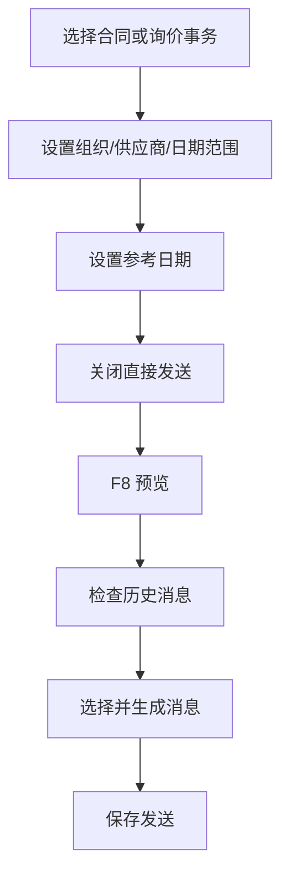

# 催收合同与询价报价

> **用途：** 使用与采购订单催交相同的预览、选择和消息控制方法，催收合同或到期报价。  
> **Transaction Code：** `ME92K`, `ME91A`  
> **来源文件：** `Mahnwesen.docx`  
> **状态：** 历史资料整理；字段、组织值、价格导入、消息输出与主数据默认值必须在当前系统验证。

## 1. 适用范围与权限

- 适用于材料扩展、采购催交和采购信息记录批量条件维护。
- 材料估价、采购条件批量导入和催交通知均属高影响操作，应执行四眼复核。
- 示例公司、人员、供应商、材料、订单和组织编号不写入匿名化流程。

## 2. 流程图

## 3. 页面与字段

| 页面/区域 | 字段或控件 | 填写/选择 | 说明与风险 |
|---|---|---|---|
| ME92K | Selektionsbild | 合同催交范围 | 方法与 ME91F 类似 |
| ME91A | Selektionsbild | 询价/报价催收范围 | 方法与 ME92F 类似 |
| Parameter | Bezugsdatum | 截止基准日 | 按合同/报价截止日判断 |
| Parameter | Nachrichten erzeugen und sichern | 保持不勾选 | 需要人工预览 |
| Ergebnisliste | Nachrichten erzeugen | 点击 | 生成催收消息 |
| Nachrichtenübersicht | Kommunikationsmittel / Verarbeitungsprotokoll | 检查 | 接收人和处理状态 |

## 4. 详细操作

1. **场景选择**  
   合同催交使用 `ME92K`；询价或到期报价催收使用 `ME91A`。
2. **筛选**  
   按组织、采购组、供应商、凭证、截止日期和参考日期筛选。
3. **预览**  
   保持直接生成并保存消息的选项关闭，按 F8 预览。
4. **审查**  
   确认合同义务、报价截止日和既有沟通。
5. **生成**  
   只标记需要催收的项目，创建消息。
6. **发送**  
   检查通信媒介和收件人后保存。
7. **证据**  
   保留消息时间、收件人和处理协议。

## 5. 完成检查

- [ ] 事务与业务场景匹配
- [ ] 截止日期正确
- [ ] 直接发送关闭
- [ ] 历史沟通已检查
- [ ] 消息收件人正确
- [ ] 处理状态成功

## 6. 待确认事项

- ⚠️ 合同和询价消息类型可能使用不同表单/输出配置。

## 7. 常见风险

- 量产或批量操作前先使用少量测试对象，并保存导出文件和处理日志。
- 不要使用历史截图中的组织值、价格、材料状态或联系人。
- 批量消息发送前不得勾选跳过预览的选项。
