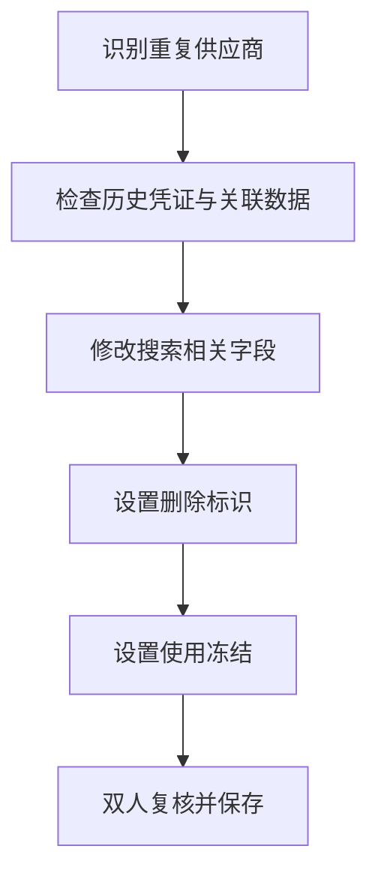

# 冻结重复供应商并设置删除标识

> **用途：** 处理迁移或主数据重复造成的供应商重复项，使其不再被采购使用或优先搜索到。  
> **SAP Transaction Code：** `XK02`, `MK02`  
> **来源：** `20180417 Anleitung Kreditor sperren.docx`  
> **状态：** 历史培训资料整理。字段、组织值、编号范围和权限须在当前 SAP 系统验证。

## 1. 适用范围与角色

- 适用于采购主数据或采购询价业务。
- 执行角色：具备相应供应商主数据或采购凭证权限的采购人员/主数据管理员。
- 涉及供应商冻结、删除标识、价格和信息记录更新时，应遵循四眼原则。

## 2. 前置条件

- 确认哪一个供应商是保留主记录，哪一个是重复记录
- 检查重复记录是否已有采购订单、收货、发票或会计凭证
- 获得主数据负责人或采购负责人的冻结批准

## 3. 流程图

## 4. SAP 页面与字段

| SAP 页面/区域 | 字段或控件 | 填写/选择 | 说明与风险 |
|---|---|---|---|
| Kreditor ändern: Einstieg | Kreditor | 重复供应商号 | 示例为 302978；不得误操作保留记录 |
| Adress-/Suchdaten | Nachname/Suchbegriff 等搜索字段 | 按公司删除标识规则改为 löschen | 源文件未显示具体字段截图，需在当前系统确认 |
| Löschvermerk | Löschvormerkung | 设置 | 删除标识不等于物理删除 |
| Sperrdaten | Einkaufssperre / Buchungssperre | 按批准范围设置 | 采购冻结与记账冻结的影响不同 |

## 5. 详细操作

1. **核对重复关系**  
   对比名称、地址、税号、银行、旧系统供应商号和采购历史，明确保留记录。
2. **检查业务影响**  
   查询未清采购订单、收货、发票和会计未清项；如存在，先确定迁移或结清方案。
3. **进入修改**  
   根据权限和数据层级使用 `XK02` 或 `MK02` 打开重复供应商。
4. **降低搜索可见性**  
   按公司规则修改源文件要求的搜索字段为 `löschen`。由于截图字段未被文本提取，必须在当前系统确认字段位置。
5. **设置控制标识**  
   设置 Löschvermerk，并按批准范围设置供应商使用冻结。
6. **复核保存**  
   由第二人复核供应商号和冻结范围后保存，并记录变更原因。

## 6. 完成检查

- [ ] 保留供应商与重复供应商没有颠倒
- [ ] 未清业务已评估
- [ ] 删除标识已设置
- [ ] 采购/记账冻结范围符合批准
- [ ] 变更原因和审批记录已保存

## 7. 待确认与资料限制

- ⚠️ 原资料未提供事务代码，也未显示“前/后”截图中的具体字段名；本文仅给出常见入口 XK02/MK02，必须在当前系统确认。

## 8. 常见错误处理

- 保存前检查 SAP 状态栏，只有出现成功消息或生成凭证号才算完成。
- 找不到字段时，先确认事务代码、采购组织、公司代码、账户组、用户权限和 SAP GUI 版本。
- 不得为解决重复供应商而物理删除历史业务数据。应按公司规则设置删除标识、采购冻结或其他使用冻结。
