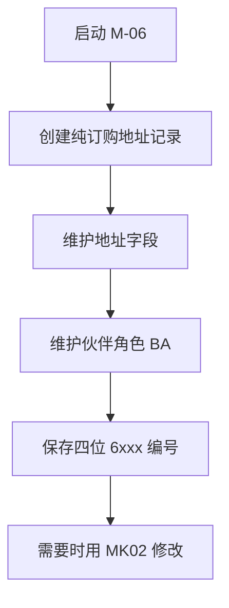

# 维护供应商的替代订购地址

> **用途：** 为同一主供应商维护不同工厂或地点的 Bestelladresse，而不创建完整供应商主记录。  
> **SAP Transaction Code：** `M-06`, `MK02`  
> **来源：** `Abweichende Kreditorenrollen.docx`  
> **状态：** 历史培训资料整理。字段、组织值、编号范围和权限须在当前 SAP 系统验证。

## 1. 适用范围与角色

- 适用于采购主数据或采购询价业务。
- 执行角色：具备相应供应商主数据或采购凭证权限的采购人员/主数据管理员。
- 涉及供应商冻结、删除标识、价格和信息记录更新时，应遵循四眼原则。

## 2. 前置条件

- 主供应商已存在
- 准备替代订购地址的法定名称和完整地址
- 确认号码范围与伙伴角色已在当前系统启用

## 3. 流程图

## 4. SAP 页面与字段

| SAP 页面/区域 | 字段或控件 | 填写/选择 | 说明与风险 |
|---|---|---|---|
| M-06 Einstieg | Kontengruppe/Nummernkreis | 当前系统配置值 | 历史设计为四位且以 6 开头 |
| Adresse | Name/Straße/PLZ/Ort/Land | 替代订购地址 | 几乎无其他必填字段 |
| Partnerrollen | BA | Bestelladresse | 无需维护三个标准必填伙伴 |
| MK02 | Kreditor | 替代地址供应商号 | 后续修改入口 |

## 5. 详细操作

1. **创建入口**  
   输入 `M-06`，进入替代订购地址创建。
2. **维护地址**  
   填写名称、街道、邮编、城市、国家及必要通信字段。
3. **伙伴角色**  
   仅维护 `BA` 作为 Bestelladresse。
4. **保存**  
   保存并记录系统生成的编号。历史方案为四位、6 开头。
5. **分配到主供应商**  
   在主供应商采购组织数据的 Partnerrollen 中分配该 BA 记录。
6. **后续维护**  
   地址变化时使用 `MK02` 修改对应记录。

## 6. 完成检查

- [ ] 地址信息完整
- [ ] 伙伴角色为 BA
- [ ] 编号范围符合当前配置
- [ ] 已分配到正确主供应商/采购组织

## 7. 待确认与资料限制

- ⚠️ 源文件说明示例时伙伴角色和编号范围尚未激活，必须确认目前系统是否已启用。

## 8. 常见错误处理

- 保存前检查 SAP 状态栏，只有出现成功消息或生成凭证号才算完成。
- 找不到字段时，先确认事务代码、采购组织、公司代码、账户组、用户权限和 SAP GUI 版本。
- 不得为解决重复供应商而物理删除历史业务数据。应按公司规则设置删除标识、采购冻结或其他使用冻结。
