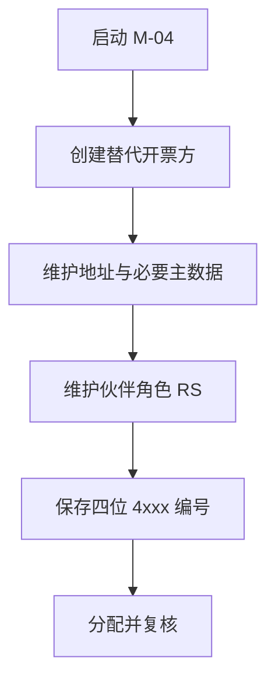

# 维护供应商的替代开票方

> **用途：** 为主供应商维护不同于订购方的 Rechnungssteller。  
> **SAP Transaction Code：** `M-04`, `MK02`  
> **来源：** `Abweichende Kreditorenrollen.docx`  
> **状态：** 历史培训资料整理。字段、组织值、编号范围和权限须在当前 SAP 系统验证。

## 1. 适用范围与角色

- 适用于采购主数据或采购询价业务。
- 执行角色：具备相应供应商主数据或采购凭证权限的采购人员/主数据管理员。
- 涉及供应商冻结、删除标识、价格和信息记录更新时，应遵循四眼原则。

## 2. 前置条件

- 主供应商已存在
- 准备开票方的法定和税务信息
- 确认号码范围与 RS 伙伴角色已启用

## 3. 流程图

## 4. SAP 页面与字段

| SAP 页面/区域 | 字段或控件 | 填写/选择 | 说明与风险 |
|---|---|---|---|
| M-04 Einstieg | Kontengruppe/Nummernkreis | 当前系统配置值 | 历史设计为四位且以 4 开头 |
| Adresse | Name/Straße/PLZ/Ort/Land | 开票方法定地址 | 发票与税务信息必须一致 |
| Partnerrollen | RS | Rechnungssteller | 不得误用 BA |
| MK02 | Kreditor | 替代开票方编号 | 后续修改入口 |

## 5. 详细操作

1. **创建入口**  
   输入 `M-04`。
2. **维护主数据**  
   填写开票方法定名称、地址及当前系统要求的税务/通信字段。
3. **伙伴角色**  
   维护 `RS` 作为 Rechnungssteller。
4. **保存**  
   保存并记录编号。历史设计为四位、4 开头。
5. **分配**  
   在主供应商采购组织 Partnerrollen 中分配 RS。
6. **验证**  
   创建测试采购订单/发票场景，确认开票方被正确确定。

## 6. 完成检查

- [ ] 伙伴角色为 RS
- [ ] 法定与税务信息正确
- [ ] 编号范围符合当前配置
- [ ] 分配到正确主供应商
- [ ] 发票场景验证通过

## 7. 待确认与资料限制

- ⚠️ 源文件说明示例时功能尚未激活，当前可用性和字段必须验证。

## 8. 常见错误处理

- 保存前检查 SAP 状态栏，只有出现成功消息或生成凭证号才算完成。
- 找不到字段时，先确认事务代码、采购组织、公司代码、账户组、用户权限和 SAP GUI 版本。
- 不得为解决重复供应商而物理删除历史业务数据。应按公司规则设置删除标识、采购冻结或其他使用冻结。
