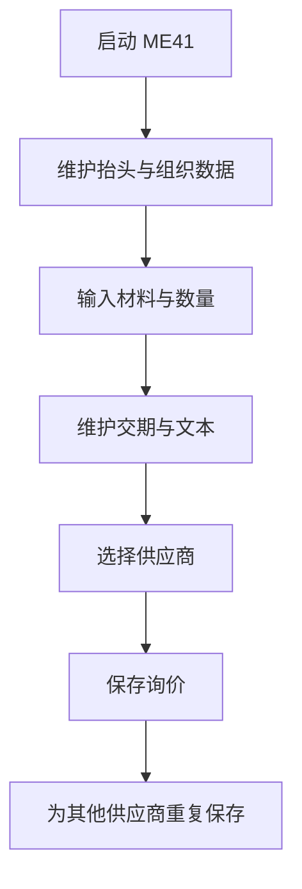

# 创建采购询价

> **用途：** 为一个供应商创建采购询价，并可连续为其他供应商创建内容相同的询价。  
> **SAP Transaction Code：** `ME41`  
> **来源：** `Anfrage anlegen, pflegen, Angebotsvergleich FERTIG.docx`  
> **状态：** 历史培训资料整理。字段、组织值、编号范围和权限须在当前 SAP 系统验证。

## 1. 适用范围与角色

- 适用于采购主数据或采购询价业务。
- 执行角色：具备相应供应商主数据或采购凭证权限的采购人员/主数据管理员。
- 涉及供应商冻结、删除标识、价格和信息记录更新时，应遵循四眼原则。

## 2. 前置条件

- 材料号、数量、交期、采购组织、采购组和供应商已知
- 明确询价截止日期 Angebotsfrist
- 需要记录批次关键词时准备 Submission

## 3. 流程图

## 4. SAP 页面与字段

| SAP 页面/区域 | 字段或控件 | 填写/选择 | 说明与风险 |
|---|---|---|---|
| Anfrage anlegen: Einstieg | Anfrageart | AN | 历史资料示例 |
| Einstieg | Sprachenschlüssel | DE | 按供应商语言调整 |
| Einstieg | Anfragedatum / Angebotsfrist | 询价日期/报价截止日 | 截止日必须现实可执行 |
| Organisationsdaten | Einkaufsorganisation | 1000 示例 | 按实际采购组织 |
| Organisationsdaten | Einkäufergruppe | F08 示例 | 按责任采购组 |
| Positionsübersicht | Material | 材料号 | 回车带出短文本和物料组 |
| Position | Anfragemenge | 询价数量 | 单位必须正确 |
| Position | Lieferdatum | 真实交期或占位日期 | 源资料称该字段不打印，但需在当前输出格式验证 |
| Kopfdaten | Submission | 关键词 | 可通过 ME4S 搜索 |
| Lieferantenanschrift | Lieferant | 单个供应商号 | 一次只加入一个供应商 |

## 5. 详细操作

1. **进入事务**  
   输入 `ME41`。
2. **入口字段**  
   填写 Anfrageart、语言、询价日期、报价截止日、采购组织和采购组，然后回车。
3. **项目数据**  
   输入材料号并回车，再输入 Anfragemenge 和 Lieferdatum。
4. **补充文本**  
   标记行项目，打开 Positionstexte，维护需要打印给供应商的要求。
5. **可选关键词**  
   在 Kopfdaten 的 Submission 中填写可搜索关键词。
6. **选择供应商**  
   点击供应商地址图标，输入一个 Lieferant 并回车。
7. **保存**  
   返回总览后保存，记录状态栏生成的询价号。
8. **连续供应商**  
   系统进入新供应商屏幕后输入下一个供应商并再次保存，生成另一询价号。

## 6. 完成检查

- [ ] Angebotsfrist 正确
- [ ] 采购组织和采购组正确
- [ ] 材料/数量/单位正确
- [ ] 交期与文本正确
- [ ] 供应商正确
- [ ] 每个供应商的询价号均已记录

## 7. 待确认与资料限制

- ⚠️ 历史资料建议未知交期时可用 31.12.2099。此类占位日期可能影响报表和自动化，当前流程应优先使用约定的公司规则。

## 8. 常见错误处理

- 保存前检查 SAP 状态栏，只有出现成功消息或生成凭证号才算完成。
- 找不到字段时，先确认事务代码、采购组织、公司代码、账户组、用户权限和 SAP GUI 版本。
- 不得为解决重复供应商而物理删除历史业务数据。应按公司规则设置删除标识、采购冻结或其他使用冻结。
