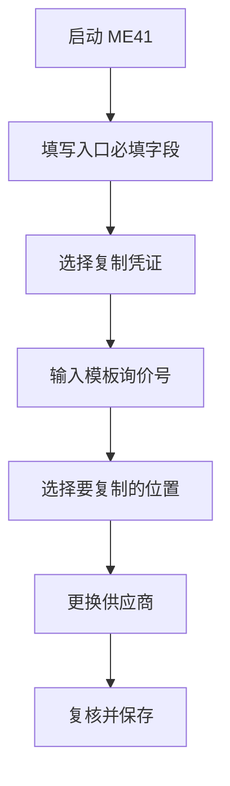

# 从已有询价复制并新增供应商

> **用途：** 以现有询价为模板复制所需位置，并为后续供应商生成新询价。  
> **SAP Transaction Code：** `ME41`  
> **来源：** `Anfrage anlegen, pflegen, Angebotsvergleich FERTIG.docx`  
> **状态：** 历史培训资料整理。字段、组织值、编号范围和权限须在当前 SAP 系统验证。

## 1. 适用范围与角色

- 适用于采购主数据或采购询价业务。
- 执行角色：具备相应供应商主数据或采购凭证权限的采购人员/主数据管理员。
- 涉及供应商冻结、删除标识、价格和信息记录更新时，应遵循四眼原则。

## 2. 前置条件

- 已有询价号可作为 Vorlagenbeleg
- 新供应商号已知
- 确认复制的材料、数量、交期和文本仍适用

## 3. 流程图

## 4. SAP 页面与字段

| SAP 页面/区域 | 字段或控件 | 填写/选择 | 说明与风险 |
|---|---|---|---|
| Anfrage anlegen: Einstieg | Anfrageart/Frist/EKOrg/EKGr | 本次询价值 | 不要机械沿用旧截止日 |
| Beleg kopieren | Vorlagebeleg | 已有询价号 | 可限定起止位置 |
| Vorlagebelegpositionen | Positionen | 标记需要复制的行 | 只复制适用项目 |
| Lieferantenanschrift | Lieferant | 新供应商号 | 回车带出地址 |

## 5. 详细操作

1. **启动**  
   输入 `ME41` 并维护本次询价的入口必填字段。
2. **打开复制**  
   点击工具栏复制凭证图标，不直接回车进入空白询价。
3. **输入模板**  
   在 Vorlagebeleg 中输入已有询价号并确认。
4. **选择位置**  
   标记需要复制的项目并点击 übernehmen。
5. **更换供应商**  
   打开 Lieferantenanschrift，输入目标供应商号。
6. **复核**  
   检查截止日、材料、数量、交期、文本和供应商。
7. **保存**  
   保存并记录新询价号。

## 6. 完成检查

- [ ] 只复制了适用位置
- [ ] 新报价截止日正确
- [ ] 供应商已更换
- [ ] 数量和交期复核
- [ ] 新询价号已记录

## 7. 待确认与资料限制

- 无新增冲突。

## 8. 常见错误处理

- 保存前检查 SAP 状态栏，只有出现成功消息或生成凭证号才算完成。
- 找不到字段时，先确认事务代码、采购组织、公司代码、账户组、用户权限和 SAP GUI 版本。
- 不得为解决重复供应商而物理删除历史业务数据。应按公司规则设置删除标识、采购冻结或其他使用冻结。
