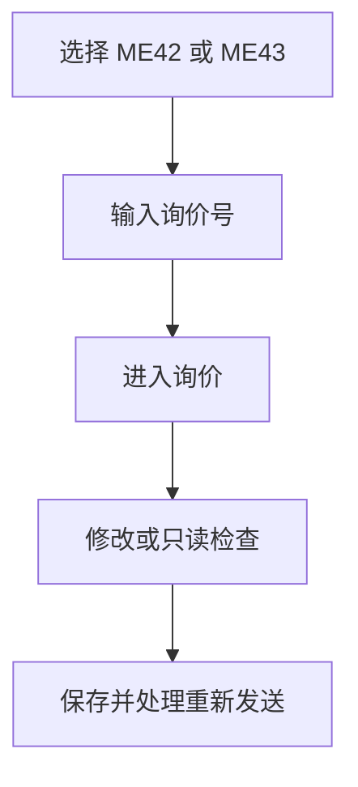

# 修改与显示采购询价

> **用途：** 修改已创建的询价，或以只读方式显示询价。  
> **SAP Transaction Code：** `ME42`, `ME43`  
> **来源：** `Anfrage anlegen, pflegen, Angebotsvergleich FERTIG.docx`  
> **状态：** 历史培训资料整理。字段、组织值、编号范围和权限须在当前 SAP 系统验证。

## 1. 适用范围与角色

- 适用于采购主数据或采购询价业务。
- 执行角色：具备相应供应商主数据或采购凭证权限的采购人员/主数据管理员。
- 涉及供应商冻结、删除标识、价格和信息记录更新时，应遵循四眼原则。

## 2. 前置条件

- 询价号已知
- 修改仍符合审批和供应商沟通状态
- 如已发送给供应商，明确是否需要重新输出

## 3. 流程图

## 4. SAP 页面与字段

| SAP 页面/区域 | 字段或控件 | 填写/选择 | 说明与风险 |
|---|---|---|---|
| Anfrage ändern: Einstieg | Anfrage | 询价号 | ME42 可修改 |
| Anfrage anzeigen: Einstieg | Anfrage | 询价号 | ME43 仅显示 |
| Positionsübersicht | Material/Menge/Termin/Text | 按需要复核 | 已发询价修改后应考虑重新发送 |

## 5. 详细操作

1. **修改**  
   输入 `ME42` 和询价号，回车进入并按 ME41 相同区域修改。
2. **保存与沟通**  
   保存后记录变更；若供应商已收到旧版，按公司流程重新输出并说明变化。
3. **显示**  
   只需查看时输入 `ME43` 和询价号；该模式没有修改权限。

## 6. 完成检查

- [ ] 询价号正确
- [ ] 修改内容已批准
- [ ] 保存成功
- [ ] 需要时已重新发送供应商

## 7. 待确认与资料限制

- 无新增冲突。

## 8. 常见错误处理

- 保存前检查 SAP 状态栏，只有出现成功消息或生成凭证号才算完成。
- 找不到字段时，先确认事务代码、采购组织、公司代码、账户组、用户权限和 SAP GUI 版本。
- 不得为解决重复供应商而物理删除历史业务数据。应按公司规则设置删除标识、采购冻结或其他使用冻结。
