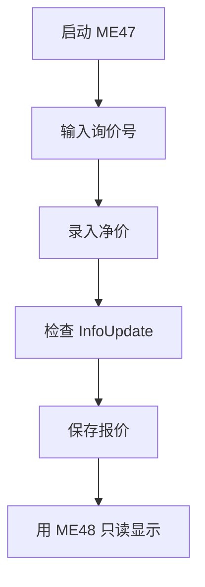

# 录入与显示供应商报价

> **用途：** 将供应商对询价的价格录入 SAP，并控制是否更新采购信息记录。  
> **SAP Transaction Code：** `ME47`, `ME48`  
> **来源：** `Anfrage anlegen, pflegen, Angebotsvergleich FERTIG.docx`  
> **状态：** 历史培训资料整理。字段、组织值、编号范围和权限须在当前 SAP 系统验证。

## 1. 适用范围与角色

- 适用于采购主数据或采购询价业务。
- 执行角色：具备相应供应商主数据或采购凭证权限的采购人员/主数据管理员。
- 涉及供应商冻结、删除标识、价格和信息记录更新时，应遵循四眼原则。

## 2. 前置条件

- 供应商报价文件已收到
- 询价号、价格、币种、价格单位、交期和有效性已核对
- 明确是否允许更新 Infosatz

## 3. 流程图

## 4. SAP 页面与字段

| SAP 页面/区域 | 字段或控件 | 填写/选择 | 说明与风险 |
|---|---|---|---|
| Angebot pflegen: Einstieg | Anfrage | 询价号 | 进入供应商对应询价 |
| Positionsübersicht | Nettopreis | 供应商报价净价 | 同时复核币种和价格单位 |
| Positionsdetails | InfoUpdate | A 或空白 | A 会创建或修改采购信息记录 |
| Angebot anzeigen | Anfrage | 询价号 | ME48 只读 |

## 5. 详细操作

1. **进入录入**  
   输入 `ME47`，填写询价号并回车。
2. **录入价格**  
   在 Nettopreis 中录入报价，并复核币种、每价单位和交货条件。
3. **控制信息记录**  
   如不应创建/修改 Infosatz，标记行项目进入 Positionsdetails，删除 InfoUpdate 的 `A`。
4. **保存**  
   保存报价。
5. **显示**  
   只读检查可用 `ME48` 输入询价号。

## 6. 完成检查

- [ ] 净价和币种正确
- [ ] 价格单位正确
- [ ] InfoUpdate 决策明确
- [ ] 报价保存成功
- [ ] 原始报价文件已归档

## 7. 待确认与资料限制

- ⚠️ 源文件只明确 Nettopreis 和 InfoUpdate A；币种、价格单位、条件字段须按当前 SAP 页面和报价文件复核。

## 8. 常见错误处理

- 保存前检查 SAP 状态栏，只有出现成功消息或生成凭证号才算完成。
- 找不到字段时，先确认事务代码、采购组织、公司代码、账户组、用户权限和 SAP GUI 版本。
- 不得为解决重复供应商而物理删除历史业务数据。应按公司规则设置删除标识、采购冻结或其他使用冻结。
