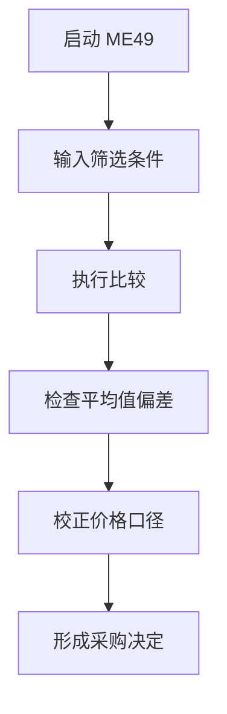

# 执行供应商报价比较

> **用途：** 按询价号或材料筛选供应商报价并比较价格偏差。  
> **SAP Transaction Code：** `ME49`  
> **来源：** `Anfrage anlegen, pflegen, Angebotsvergleich FERTIG.docx`  
> **状态：** 历史培训资料整理。字段、组织值、编号范围和权限须在当前 SAP 系统验证。

## 1. 适用范围与角色

- 适用于采购主数据或采购询价业务。
- 执行角色：具备相应供应商主数据或采购凭证权限的采购人员/主数据管理员。
- 涉及供应商冻结、删除标识、价格和信息记录更新时，应遵循四眼原则。

## 2. 前置条件

- 参与比较的供应商报价已用 ME47 完整录入
- 统一币种、价格单位、数量基础和附加成本口径
- 明确非价格评价标准

## 3. 流程图

## 4. SAP 页面与字段

| SAP 页面/区域 | 字段或控件 | 填写/选择 | 说明与风险 |
|---|---|---|---|
| Angebotspreisvergleich | Anfrage/Material | 询价号或材料号范围 | 限定同一可比范围 |
| Selektionsbild | Ausführen | 执行 | 生成比较结果 |
| Vergleichsergebnis | Prozentabweichung | 系统计算 | 相对该物料全部报价平均值的偏差 |

## 5. 详细操作

1. **启动**  
   输入 `ME49`。
2. **筛选**  
   按询价号、材料号或其他可用参数限定比较范围。
3. **执行**  
   点击 Ausführen。
4. **阅读结果**  
   百分比表示各报价相对该物料所有报价平均值的偏差，不是相对最低价。
5. **可比性校正**  
   在采购决定前另外核对币种、价格单位、运费、关税、付款条件、MOQ、交期和质量。
6. **形成记录**  
   保存或导出比较结果，并记录选择理由。

## 6. 完成检查

- [ ] 所有报价已录入
- [ ] 币种与价格单位可比
- [ ] 附加成本已考虑
- [ ] 百分比含义理解正确
- [ ] 采购决定和理由已记录

## 7. 待确认与资料限制

- 无新增冲突。

## 8. 常见错误处理

- 保存前检查 SAP 状态栏，只有出现成功消息或生成凭证号才算完成。
- 找不到字段时，先确认事务代码、采购组织、公司代码、账户组、用户权限和 SAP GUI 版本。
- 不得为解决重复供应商而物理删除历史业务数据。应按公司规则设置删除标识、采购冻结或其他使用冻结。
