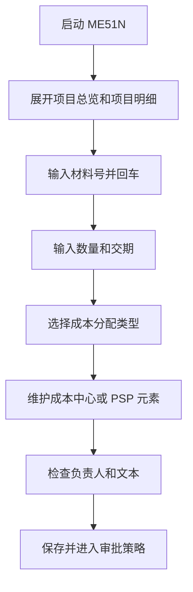

# 创建标准采购申请 BANF

> **用途：** 由实际需求人创建采购申请，使采购部门能够在 SAP 中生成采购订单。  
> **SAP Transaction Code：** `ME51N`  
> **来源：** `BANF erstellen.PDF`  
> **状态：** 根据历史培训资料更新。字段、权限、放行策略和自定义事务必须在当前 SAP 系统验证。

## 1. 适用范围与角色

- 适用于 ZIEGLER 采购申请、采购订单确认和采购监控。
- 角色包括需求申请人、审批人、采购员和负责 Disponent。
- 涉及成本对象、交期确认、统计相关交期和订单数量时，必须核对原始凭证并保留四眼原则。

## 2. 流程图

## 3. SAP 页面与字段

| SAP 页面/区域 | 字段或控件 | 填写/选择 | 说明与风险 |
|---|---|---|---|
| ME51N | Belegart | NB Bestellanforderung | 历史截图中的标准采购申请类型 |
| Positionsübersicht | Material | 材料号 | 回车后 SAP 带出短文本、单位等主数据 |
| Positionsübersicht | Menge | 需求数量 | 输入后回车 |
| Positionsübersicht | Lieferdatum | 需求交期 | 必须符合实际需求 |
| Positionsübersicht | K Kontierungstyp | K 或 Q | K=Kostenstelle；Q=PSP-Element |
| Positionsdetail > Kontierung | Kostenstelle | 成本中心 | Kontierungstyp K 时必填 |
| Positionsdetail > Kontierung | PSP-Element | PSP 元素 | Kontierungstyp Q 时必填 |
| Positionsdetail > Ansprechpartner | Disponent/Einkäufer | 系统确定 | 确认负责处理 BANF 的人员 |
| Positionsdetail > Texte | Positionstext | 外部物料号、收货人等 | 该文本会传递给供应商 |

## 4. 详细操作

1. **进入事务**  
   输入 `ME51N`，展开 Positionsübersicht 和 Positionsdetail。
2. **材料**  
   输入 Material 并按 Enter，让 SAP 自动带出物料主数据。
3. **数量与交期**  
   输入 Menge 和 Lieferdatum，并复核单位、工厂、库存地点和采购组。
4. **成本分配**  
   在列 `K` 选择 Kontierungstyp。成本中心采购用 `K`，PSP 承担用 `Q`。
5. **成本对象**  
   在 Positionsdetail > Kontierung 填写 Kostenstelle 或 PSP-Element。确认 Sachkonto 等自动确定值合理。
6. **负责人**  
   在 Ansprechpartner 页签确认 Disponent/Einkäufer。
7. **特殊备件**  
   底盘备件历史资料指定 MAN Ersatzteile 使用材料 `1091346`，Mercedes Ersatzteile 使用 `1091347`。MB 物料需求使用对应统购材料，例如办公用品 `MB-02`。
8. **文本**  
   在 Texte 中填写 Fremdmaterialnummer 和 Empfänger。由于文本会进入给供应商的订单，禁止写内部敏感说明。
9. **保存**  
   保存 BANF，触发 Freigabestrategie；记录 BANF 号并等待主管批准和采购员处理。

## 5. 完成检查

- [ ] Material、数量、单位和交期正确
- [ ] Kontierungstyp 与成本对象匹配
- [ ] Kostenstelle 或 PSP-Element 有效
- [ ] Disponent/Einkäufer 正确
- [ ] 供应商可见文本已复核
- [ ] BANF 已保存并进入正确放行策略

## 6. 待确认与资料限制

- ⚠️ 材料 1091346、1091347 和 MB-02 来自 2018 年资料，使用前须确认当前主数据仍有效。
- ⚠️ 实际 Freigabestrategie 可能已迁移到 S/4HANA/Fiori 工作流，需按当前系统确认。

## 7. 错误处理和风险

- 只有 SAP 状态栏出现成功消息、生成 BANF 号或确认行出现绿色状态时，才视为完成。
- 批量处理前必须检查已选中的行。模板值只应应用到实际需要修改的行项目。
- 交期、数量或成本对象错误会影响采购、预算和供应商评价，不应仅依赖系统默认值。
